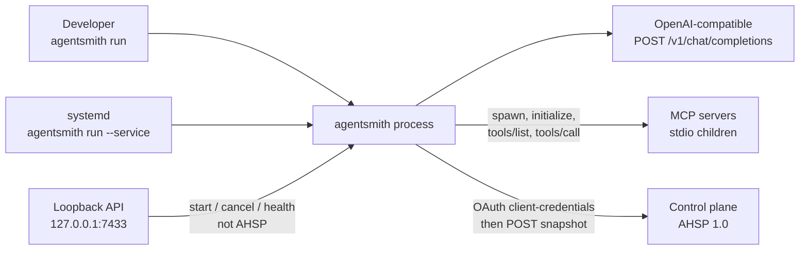
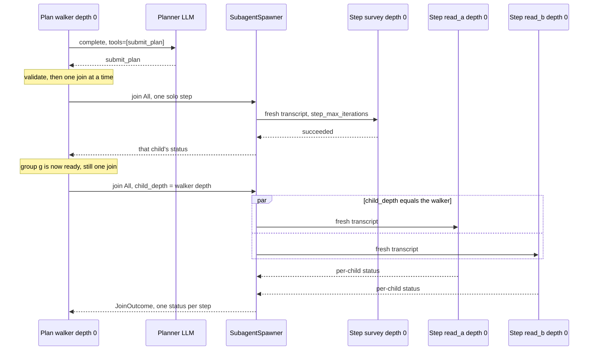
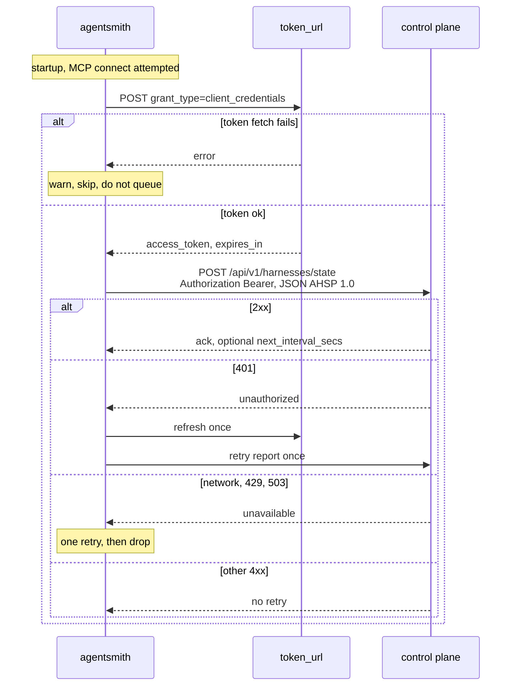

# AgentSmith 2 — Lightweight Agent Harness

| | |
|---|---|
| **Author** | Kevin Bayes |
| **Date** | 2026-10-21 |
| **Status** | Draft |
| **Audience** | Senior engineers implementing a greenfield repo |
| **Destination** | `/home/kevinbayes/workspace/git/agentsmith-2` (empty; nothing in-tree to extend) |
| **Supersedes** | The harness shape of [kevinbayes/agentsmith](https://github.com/kevinbayes/agentsmith/tree/develop) and the service/reporter idea of [kevinbayes/agentsmith-worker](https://github.com/kevinbayes/agentsmith-worker/tree/develop). It does not supersede the worker’s chat-bridge product. |

## Overview

AgentSmith 2 is a single Rust binary, `agentsmith`, that runs an agent task in the foreground or sits under systemd and reports host and harness state to a remote control plane. The caller picks one of two execution modes: a **plan + execute** walker whose executor can fan out in-process subagents and join them, or a classic **ReAct** loop. Both modes share one tool registry. Built-in tools and tools discovered from MCP servers (stdio in v1) are the same kind of object to the model.

The harness is deliberately smaller than the previous framework. That repo’s value, for this design, is the crate split (shared types, agent runtime, tools, a binary, a protocol), not ArangoDB, Redis, the account/web frontend, the JWKS middleware, or the set of provider-specific HTTP clients. `llm.provider` selects `openai`, `anthropic`, or `gemini` at deploy time. OpenAI-compatible servers still share one adapter. The previous worker’s value is the daemon lifecycle and the authenticated state POST, not Signal/Slack/Telegram bridging and not supervision of third-party CLIs.

The wire contract is a new versioned protocol, **AHSP 1.0** (AgentSmith Harness State Protocol). It is telemetry push only. The control plane acks a snapshot; it does not start, stop, or cancel runs in v1.

### Run the process in a sandbox

v1 recommends that the `agentsmith` process run inside an external sandbox the operator provides. The harness does not create that sandbox. There is no sandbox driver and no sandbox config in v1. The `shell` tool stays an unsandboxed `sh -c` inside the process. An operator who runs the binary on the host without an external sandbox has host-level execution when `shell` is enabled. Run it in a sandbox anyway. Built-in sandbox backends are a named follow-up, not this release. See [Open Questions](#open-questions).

## Background and Motivation

### What the old framework actually is

[agentsmith](https://github.com/kevinbayes/agentsmith/tree/develop) `develop` is an edition-2021 workspace. The root [`Cargo.toml`](https://github.com/kevinbayes/agentsmith/blob/develop/Cargo.toml) package is named `agentsmith` and lists members:

- `agentsmith-common` — `config`, `database`/`sql`, `disk`, `error`, `event`, `model`, `redis`, `security` (JWKS)
- `agentsmith-agent` — agent enum, factory, specification, simple and human agents; LLM trait plus many providers; memory repositories (Arango and disk); prompt repository; tools
- `agentsmith-engineers` — CLI binary
- `agentsmith-eval`
- `agentsmith-orchestrator`
- `agentsmith-runtime` — includes `simple/swarm.rs`
- `agentsmith-worker` — a thin crate inside this repo, unrelated to the remote-worker repo below
- `agentsmith-web` — account/person HTTP API and a Vite frontend

`agentsmith-interface` (HTTP handlers, JWT middleware) is in the tree and is **not** a workspace member. The root README is one line plus a note that docs are generated with Docusaurus and mdBook: “An agent framework and lowcode environment for task automation.”

The agent model is an enum, not a loop. `Agent` in `agentsmith-agent/src/agent/agent.rs` is `SimpleAgent` or `HumanAgent`. `AgentConfig` carries `id`, `name`, `description`, `type`, `system_prompt`, an `LLMConfiguration`, a `MemoryConfiguration`, and a `toolbox: Vec<AgentTool>`. `AgentSpecification` in `agent_specification.rs` wraps that config with `role` and `tags`. `HumanAgent::chat_completion` is `todo!()`. `SimpleAgent::new` accepts only `type == "simple"`.

The LLM surface is `GenerateText::generate` in `agentsmith-agent/src/llm/llm.rs`, returning `LLMResult { message, result, tool_calls }`. `LLMResultToolCall::from_openai` parses OpenAI-shaped `tool_calls[]` (`id`, `type`, `function.name`, `function.arguments` as a JSON **string**). `from_cerebras`, `from_sambanova`, `from_groq`, and `from_grok` all go through `OpenAIGenerateResponse`. `from_anthropic` is a separate content-block parser. Provider modules on `develop` are `anthropic_llm`, `cerebras_llm`, `gcp_gemini_llm`, `grok_llm`, `groq_llm`, `huggingface_tgi_llm`, `llamafile_llm`, `openai_llm`, and `sambanova_llm`, selected by `llm_factory`.

Tools are a closed enum. `agentsmith-agent/src/tools/tool.rs` defines `enum Tool { CallAgentTool, SimpleJsonWebClientTool }` and `SimpleToolExecution::execute`. `ToolRegistry` in `registry.rs` is `HashMap<String, Arc<Tool>>` behind `Arc<RwLock<_>>` (`SafeToolRegistry`). `CallAgentTool::execute` does not run an agent; it echoes `input` into a `ToolResult`. The actual handoff lives in the swarm.

`Swarm::run` in `agentsmith-runtime/src/simple/swarm.rs` is the only real loop. It records messages into `Memory::MESSAGES`, calls `agent.chat_completion`, and on tool calls dispatches by `tool_call.type_`: `"agent"` sets `active_agent` to `tool_call.name` (a serial handoff, one active agent), `"function"` looks up the registry. A missing tool becomes a `ToolResult` whose value is `{ "error": "Tool not found in tool registry." }`, and a failed `execute` becomes `{ "error": "Error calling tool." }`. Neither aborts the process. Execute failures are then appended to memory. Not-found results are not: `append_tool_call_result_to_memory` looks the tool up again and drops the result when `get_tool` returns `None`, so the model never sees “tool not found.” v1 must append both. The loop stops by setting `turn = max_turns` when the model returns no tool calls, then increments `turn` once more. `max_turns` is a `u16`. The swarm test constructs one with `5`. `agentsmith-runtime/src/lib.rs` itself is only `mod simple; fn main() { println!("Hello, world!"); }`.

`agentsmith-engineers/src/main.rs` is a clap CLI, “AgentSmith Engineers”, subcommands `lead`, `architect`, `engineer`, `reviewer`, `qa`, `writer`, and `cli`, with `--config` defaulting to `./sample-config.json` and `--working-dir`. Prompts are Jinja files under `agentsmith-engineers/prompts/`. That role catalogue is a product, not a harness.

`proto/agent.proto` and `agentsmith-agent/proto/agent.proto` are the same stub: `service AgentService { rpc AskAgent (Request) returns (Response); }` with `uint64 id` on both messages. There is no harness state in protobuf.

`SystemError` in `agentsmith-common/src/error/error.rs` is a serializable enum of numeric `{ id: u8, code: u16 }` variants (`LLMError`, `ToolError`, `AgentError`, `JwksError`, …). It does not carry a source message. That style is not worth keeping.

Pain that this design refuses to inherit:

- Memory, prompts, and agents have Arango and disk repository pairs, plus Redis and SQL modules in `agentsmith-common`. Most of that is unused weight relative to a single run’s transcript.
- Nine HTTP clients implement more than two wire shapes. Five functions share the OpenAI parser: `from_openai`, `from_groq`, `from_cerebras`, `from_sambanova`, and `from_grok`. `llamafile_llm.rs` does not. It is a Gemini-shaped client (`GeminiLLM`, `generateContent`). `from_anthropic` and `gcp_gemini_llm` are their own shapes. `huggingface_tgi_llm` is a stub.
- `Tool` as an enum means every MCP server tool would be a new variant. The `ToolClone` boilerplate on `AgentEnvironment` in `agent.rs` exists because of that.
- `Swarm` can switch the active agent, but it cannot fan out. Children would share `Memory` and `active_agent`. That is the opposite of isolated subagents.
- `AskAgent` is not a control-plane protocol.

### What the old worker actually is

[agentsmith-worker](https://github.com/kevinbayes/agentsmith-worker/tree/develop) `develop` builds `agentsmith-remote-worker`. `src/lib.rs` modules are `agent`, `agent_mgmt`, `command`, `hermes`, `config`, `error`, `llm`, `messaging`, `monitor`, `reporter`, `router`, `scheduler`, `session`, `shutdown`. `src/main.rs` uses clap, tokio, and `CancellationToken`. It starts Signal (feature-gated), Slack, Telegram, and web adapters, then a `Router`. That bridge — chat in, third-party CLI out — is **not** being rebuilt.

What is being kept is the shape of “install me as a service and POST state”:

- `install.sh` downloads a release and writes a systemd unit. User mode (default): binary `~/.local/bin`, config `~/.config/agentsmith/config.toml`, data `~/.local/share/agentsmith`, unit `~/.config/systemd/user/agentsmith-worker.service`. System mode (`--system`): `/usr/local/bin`, `/etc/agentsmith`, `/var/lib/agentsmith`, user `agentsmith`, unit `/etc/systemd/system/agentsmith-worker.service` with `ProtectSystem=full`, `ProtectHome=read-only`, `NoNewPrivileges=true`, `Restart=on-failure`, `RestartSec=5`, `After=network-online.target`. `--no-service` and `--no-start` exist. Non-Linux skips the unit.
- `src/shutdown.rs` cancels a `CancellationToken` on SIGINT and SIGTERM (Unix) or Ctrl-C (Windows).
- `ReporterConfig` in `src/config.rs` is `enabled` (default false), `endpoint`, `token_url`, `client_id`, `client_secret`, `worker_name`, `interval_secs` (default 30 via `default_report_interval_secs`). Env overrides are `AGENTSMITH_REPORTER_*`, applied imperatively in `Config` load, not a generic mapper.
- `PROJECT.md` on `develop` is an empty file (git empty blob, size 0). It contributes nothing.

`documentation/REPORTER_API.md` is the written contract. `src/reporter.rs` has drifted from it. Both are cited in [AHSP 1.0](#ahsp-10-harness-state-protocol). The drift is the reason v1 does not grow a command channel “because the worker already sort of has one.”

## Key Decisions

1. **One process, two strategies, one binary.** `ReactLoop` and `PlanExecuteLoop` implement `AgentLoop` inside `agentsmith-runtime`. The CLI flag and the agent spec select one. They are not stacked: plan+execute does not wrap a free-running ReAct of the parent, and ReAct cannot spawn subagents. Rejected alternative: two binaries. Rationale under [Alternatives](#alternatives-considered).

2. **Subagents are in-process tasks, not a worker mesh.** `tokio::spawn` in the same binary. A child gets a new transcript and an explicit brief. It does not get the parent message list. The control plane is the only remote peer. Depth, fan-out, and live-child caps are hard limits (table below).

3. **Join-all only in v1.** Timeouts and cancellation are in v1. Join-any and join-n are not. A one-variant `JoinPolicy::All` keeps the extension point named without a second implementation.

4. **Tool errors are observations.** The swarm recorded execute failures as `{ "error": "Error calling tool." }`. It built the same shape for a missing tool, then `append_tool_call_result_to_memory` dropped that result because the second lookup missed. v1 appends both, with a typed envelope, and adds a consecutive-error cap so a stuck model cannot spin forever. LLM authentication failures and exhausted retries are fatal to the run. They are not fed back as tool results. A tool-call `arguments` string that is not JSON is an `invalid_args` observation, not a panic and not a fatal `complete` error. `Length` and `ContentFilter` with no tool calls fail the run; they are not success.

5. **Three chat providers, chosen at deploy time.** `llm.provider` is `openai`, `anthropic`, or `gemini`. The default is `openai`. `Llm` stays dyn-compatible, so the loop does not match on the provider. `openai` is the OpenAI chat-completions adapter and covers any server that speaks `/v1/chat/completions` (Groq, Cerebras, SambaNova, Grok, and a real llamafile) by setting `llm.base_url`. `anthropic` posts to the Messages API. `gemini` posts to `generateContent`. When `base_url` is left at the OpenAI default, Anthropic and Gemini use their own API roots.

6. **Trait objects for tools, not an enum.** MCP tools and builtins must register without a crate-wide match. This deliberately diverges from `enum Tool` in `tools/tool.rs`.

7. **MCP is an in-process stdio client.** Streamable HTTP is not v1. A down server unregisters its tools and is retried; it does not crash the process unless that server is marked `required`.

8. **AHSP 1.0 is push-only.** The documented reporter is push-only. The code in `reporter.rs` is not: it wraps the body in `CommandEnvelope { command: "state_report", state_report, results }` and will execute `AgentCommandKind` values returned by the plane (`Install`, `Update`, `Remove`, `Kill`, `Status`, `List` in `src/agent_mgmt/protocol.rs`). v1 does not copy that channel. A compromised or buggy plane must not be able to spawn work or kill processes. Local start/cancel exists only on a loopback API. Full rationale under [Push-only](#decision-push-only).

9. **Snapshots, not deltas and not a disk queue.** Each report is a full picture. A lost POST heals on the next success. There is still no disk queue. The in-memory retry rules are the table in [Errors and retries](#errors-and-retries): one retry for transport failure, timeout, 429, and 503; one token refresh plus one report retry on 401/403; one shrink-and-retry on 413. Other 4xx are not retried. A client retry is a new snapshot (new `report_id`, new `sequence`). `report_id` dedupe is only for a proxy that replays the same bytes.

10. **Edition 2021, tokio, no `panic = "abort"`.** Edition stays 2021 to match both prior repos. Nothing in v1 needs edition-2024 language features. Async is tokio because `agentsmith-worker` already runs on it (`#[tokio::main]`, `mpsc`, `CancellationToken`, `tokio::signal`) and because `Swarm::run` is already async. Task panics must not abort the service: a child `JoinError` becomes a failed subagent. Do not set `panic = "abort"` in the release profile.

11. **No database.** The transcript is a `Vec` in the run. Optional local JSONL is a debug log, not memory. Arango, Redis, and SQLite do not come back.

### Quantitative defaults

| Limit | Default | Hard ceiling enforced in code | Config |
|---|---|---|---|
| ReAct iterations | 25 | 100 | `loop.react_max_iterations` |
| Iterations inside one plan step | 8 | 50 | `loop.step_max_iterations` |
| Planner attempts | 2 | 2 | `loop.planner_attempts` (values above 2 rejected at load) |
| Plan steps | — | 32 | not configurable in v1 |
| Subagent depth | 2 | 4 | `loop.max_subagent_depth`. A root plan walker and every walker-created step, solo or grouped, are depth 0. Those joins set `SpawnRequest.child_depth` to the walker’s depth and do not consume a level. Only a model call to `spawn_subagents` sets `child_depth = caller.depth + 1`. That tool is offered only while `caller.depth < max`. The spawner assigns `child_depth` and does not increment. |
| Fan-out per `spawn_subagents` call | 8 | 8 | `loop.max_fanout` cannot exceed 8 |
| Live subagents per root run | 16 | 32 | `loop.max_live_subagents` |
| Spawn/join timeout | 120s | 600s | `loop.spawn_timeout_secs` |
| Consecutive tool errors before ReAct/step abort | 5 | 20 | `loop.max_consecutive_tool_errors` |
| Shell timeout | 30s | 120s | `tools.shell.timeout_secs`, `tools.shell.max_timeout_secs` |
| Tool output returned to the model | 32 KiB | 32 KiB | `tools.max_output_bytes` |
| `read_file` | 64 KiB | 256 KiB | `tools.files.max_read_bytes` |
| `write_file` | 256 KiB | 1 MiB | `tools.files.max_write_bytes` |
| Child summary copied into the parent | 4 KiB | 4 KiB | fixed |
| Report interval | 30s | clamp 10s–300s | `reporter.interval_secs` |
| Report HTTP timeout | 10s | 30s | `reporter.timeout_secs` |
| Token refresh skew | 30s | — | `reporter.token_skew_secs` |
| Max report body | 256 KiB (262144) | 256 KiB | `reporter.max_body_bytes` cannot exceed 262144 |
| LLM HTTP timeout | 120s | 300s | `llm.timeout_secs` |
| LLM retries on 429/5xx | 2 | 4 | `llm.retries` (backoff 500ms, then 1500ms, plus jitter) |
| Root runs inside the service | 2 | 8 | `service.max_runs`. Config load also rejects `max_runs * (1 + max_live_subagents) > 64`, so every non-terminal run fits in the AHSP `runs` array (`maxItems: 64`). Defaults are 2 × 17 = 34. |
| Shutdown grace | 15s | 60s | `service.shutdown_grace_secs` |
| MCP connect timeout | 10s | 60s | per server |
| MCP call timeout | 60s | 300s | per server |
| Host `cmd_summary` / task title | 120 chars | 120 | fixed. Char boundary: if more than 120 Unicode scalar values, keep 117 and append `...`. Do not copy `monitor.rs`, which slices bytes at `[..117]` and can panic. |
| Service bind | `127.0.0.1:7433` | loopback only | `service.bind` |

Expected load for the design target, one harness per machine: 0–2 root runs, at most 8 concurrent LLM calls during a fan-out (live cap 16, but a single spawn is capped at 8), one state POST every 30s. A full 256 KiB body every 30s is about 8.5 KiB/s and is the abuse case; a normal report is a few kilobytes. Harness overhead added to a tool call, excluding the tool’s own work and the LLM, should stay under 5 ms. Local `POST /v1/runs` returns in under 50 ms and does not wait for the model. The report POST budget is the 10s timeout.

## Goals and Non-Goals

### Goals

- Foreground `agentsmith run` for one task, and `agentsmith run --service` as a long-running process.
- `agentsmith install` / `uninstall` for a systemd user unit or system unit.
- Plan+execute and ReAct, selected per run, with the limits above.
- A small builtin tool set and an MCP stdio client sharing one registry.
- AHSP 1.0 so a control plane can be written against a schema, not an informal JSON blob.
- TOML config with explicit env overrides.
- Secrets, prompt bodies, and file contents never leave the process in a report or in an info log.
- The process is run inside an external sandbox the operator provides. The binary does not create that sandbox.

### Non-goals

- Chat bridges (Signal, Slack, Telegram, web dashboard). The worker’s `messaging::*`, `router`, and `session` stay behind.
- Installing or killing third-party CLIs (`agent_mgmt` recipes, `Install`/`Kill` commands).
- Distributed subagents, a worker mesh, or remote task placement.
- ArangoDB, Redis, SQLite, account management, a Vite frontend, JWKS, eval (`agentsmith-eval`), the engineer role CLI, Jinja prompt packs.
- HuggingFace TGI stays out until someone maps it onto `OpenAiCompatible` with a base URL. Anthropic and Gemini are `llm.provider` values, not extra OpenAI parsers.
- Streamable HTTP MCP, MCP resources/prompts/sampling/oauth, join-any, join-n, human-in-the-loop (`HumanAgent` was already `todo!()`).
- A control plane implementation in this repo. AHSP is the contract; the server is someone else’s.
- Windows Service Control Manager, launchd, Snap. Windows and macOS may run `agentsmith run` in a terminal later; v1 install is Linux systemd only, matching the useful part of `install.sh`. The old `shutdown.rs` Windows Ctrl-C branch is not required for v1.
- Replanning. If a step fails, dependents are skipped. The planner is not called again.
- Multimodal tool results. MCP image content becomes the text `[image omitted]`.
- Parallel execution of sibling tool calls inside one assistant turn. Calls run in listed order, as in `Swarm::handle_function_calls`. Fan-out is the subagent primitive, not a silent `asyncio.gather` of `shell`.
- A built-in sandbox driver, a sandbox config section, or a sandbox install path. Those backends are a named follow-up: NVIDIA OpenShell, LXC with mounts, and Mac containers. v1 does not pick one and does not define an API for them. File-tool path jails stay. The systemd unit’s `ProtectSystem`, `ProtectHome`, and `NoNewPrivileges` stay. Those unit settings are service hardening, not the workload sandbox.

## Crate and Module Map

Workspace edition is **2021**. The root `Cargo.toml` is a virtual workspace with no `[package]` of its own. The old root declared a package named `agentsmith` with empty dependencies and a workspace; that package did nothing. The binary name `agentsmith` comes from `agentsmith-cli`.

```
agentsmith-2/
  Cargo.toml
  agentsmith-core/
  agentsmith-llm/
  agentsmith-tools/
  agentsmith-mcp/
  agentsmith-runtime/
  agentsmith-protocol/
  agentsmith-cli/          # [[bin]] name = "agentsmith"
```

### Old crate to new crate

| Old | New | What happens |
|---|---|---|
| `agentsmith-common` (`config`, `error`, and the unused `database`, `redis`, `disk`, `security`, `event`, `model`) | `agentsmith-core` | Config, errors, ids, redaction. Storage and JWKS are dropped. |
| `agentsmith-agent` LLM modules + `llm.rs` + `prompt.rs` | `agentsmith-llm` | Trait plus `openai`, `anthropic`, and `gemini`. The five OpenAI-shaped clients stay one adapter. |
| `agentsmith-agent` `tools/` | `agentsmith-tools` | Trait, registry, builtins. `web_tool.rs` is not ported; a general HTTP client is not a builtin. |
| (did not exist) | `agentsmith-mcp` | Stdio client. Depends on `agentsmith-tools`, not the reverse, so tools compile without `rmcp`. |
| `agentsmith-agent` `agent/` + `memory/` + `prompt/repository` | `agentsmith-runtime` (`spec`, `transcript`) | Spec is a file. Memory is a `Vec<Message>`. Repositories are dropped. |
| `agentsmith-runtime` `simple/swarm.rs` | `agentsmith-runtime` `react`, `plan`, `spawn` | Handoff-by-`active_agent` is replaced by isolated fan-out. |
| `agentsmith-engineers` | `agentsmith-cli` `run` | Role subcommands and Jinja are dropped. One `run` command remains. |
| `agentsmith-worker` in the framework repo | dropped | It was a placeholder, not the daemon. |
| `agentsmith-worker` repo `reporter`, `shutdown`, `install.sh`, `config` daemon/reporter fields | `agentsmith-cli` `reporter`, `shutdown`, `install` | Reimplemented against AHSP. Messaging, scheduler, hermes, agent_mgmt are not ported. |
| `proto/agent.proto` | `agentsmith-protocol` | JSON schema plus serde types. Protobuf is not carried forward. |
| `agentsmith-orchestrator`, `agentsmith-eval`, `agentsmith-interface`, `agentsmith-web` | dropped | They do not earn a crate. |

### Modules

```
agentsmith-core/src/{lib,error,config,redact,id}.rs
agentsmith-llm/src/{lib,openai,types}.rs
agentsmith-tools/src/{lib,tool,registry,builtin/{read_file,write_file,list_dir,shell,finish}}.rs
agentsmith-mcp/src/{lib,client,stdio,supervisor,install_tools}.rs
agentsmith-runtime/src/{lib,loop_,react,plan,spawn,supervisor,transcript,spec,snapshot}.rs
agentsmith-protocol/src/{lib,report,ack}.rs
agentsmith-protocol/schema/ahsp-1.0.json
agentsmith-cli/src/{main,shutdown,reporter,host_watch,local_api}.rs
agentsmith-cli/src/commands/{config,run,service,install}.rs
```

Dependency direction: `protocol` depends only on serde, chrono, and uuid. `runtime` does not depend on `protocol` or `mcp`. `cli` maps `runtime::RunSnapshot` plus a `HostSnapshot` from `host_watch` into `protocol::StateReport` and is the only crate that depends on both. `mcp` depends on `tools` and wraps `rmcp`.

Lock `rmcp` at **3.6.0** (`rust-version = "1.88"`, edition 2024). Features: `client` and `transport-child-process` only. Default features stay off (`server` and `macros` are defaults and must not be enabled). Do not enable `auth` or `transport-streamable-http-client`. Workspace MSRV is **1.88**, the locked crate’s `rust-version`, not 1.85. Depending on an edition-2024 crate from an edition-2021 crate is allowed. Our `McpClient` trait hides `rmcp` types.

`Peer::call_tool` drives follow-up rounds (sampling, tasks, elicitation). v1 has no UI for those and does not implement sampling. The call path is `Peer::list_all_tools` and `Peer::call_tool_once` (“one `tools/call`, without driving any follow-up rounds”). An `InputRequired` or task-shaped response is a tool observation `kind: "execution"`, message `"mcp follow-up not supported"`. It does not start another round. `TokioChildProcess` is one value: the child and the stdio transport. `TokioChildProcess::builder` inherits stderr. Record `id()` and then `ServiceExt::serve`, which consumes that value and returns `RunningService`. That is the only handle the client keeps. Do not call `into_inner` and do not keep a second child. Shutdown is `RunningService::close_with_timeout` within the remaining process grace. That close is `TokioChildProcess::graceful_shutdown`: close stdin, wait 3s (`MAX_WAIT_ON_DROP_SECS`), then kill. Do not send SIGTERM and do not SIGKILL at 2s. If `close_with_timeout` returns `Ok(None)`, SIGKILL the pid recorded before `serve`. The same sequence is under [Graceful shutdown](#graceful-shutdown) and in PR 6.

## Proposed Design

### Context



Subagents are boxes inside `bin`, not extra nodes. They share the process, the file system, and the environment. They do not share transcripts.

### Execution modes

The caller selects the mode. There is no default. CLI and `POST /v1/runs` both call one function:

```rust
pub fn resolve_mode(explicit: Option<LoopMode>, spec: Option<&AgentSpec>) -> Result<LoopMode, Error> {
    if let Some(mode) = explicit {
        return Ok(mode);
    }
    if let Some(spec) = spec {
        return Ok(spec.mode);
    }
    Err(Error::Config(
        "mode is required: pass --mode or JSON mode, or set mode in the spec".into(),
    ))
}
```

CLI `explicit` is `--mode` when the flag is present. HTTP `explicit` is the JSON `mode` field when it is present (the field is optional). Both then load `spec_path` / `--spec` if set. A missing mode after that is a usage error (CLI exit 2, HTTP 400), not a silent ReAct.

```rust
#[derive(Clone, Copy, Debug, PartialEq, Eq, serde::Serialize, serde::Deserialize)]
#[serde(rename_all = "snake_case")]
pub enum LoopMode {
    React,
    Plan,
}
```

Both strategies are driven by `AgentLoop::run` (sketch in [Interfaces](#api-and-interface-changes)). The supervisor owns the `CancellationToken`, the live-child counter, and the snapshot the reporter reads.

#### ReAct

`ReactLoop` is the swarm loop with the handoff removed and the stop rules made explicit.

Each iteration:

1. Build a chat-completions request from the transcript, the spec’s system prompt, and this run’s visible tool list (`RunTools::definitions`, not the process-wide map). `tool_choice` is `"auto"`. Do not send the old `disable_parallel_tool_use` vendor extension; if the model returns several tool calls anyway, execute them **sequentially** in the order returned.
2. Call `Llm::complete`. A parse failure of one tool call’s arguments does not fail `complete`.
3. Append the assistant message.
4. Apply the stop table below. If the table says to execute tool calls, resolve each name with `RunTools::get` (allow-list enforced). A name that is registered in the process but absent from this run’s list is `not_found`. An `arguments` value of `None` is `invalid_args` and the implementation is not called. Append one tool message per call. Increment the iteration.
5. Repeat until a stop condition ends the run.

Stop conditions, first match wins. `error_kind` is the string stored on the run and copied into AHSP. `LlmErrorKind` maps to `auth`, `bad_request`, `unavailable`, and `timeout`.

| Condition | Run status | `error_kind` | Fatal to the process? |
|---|---|---|---|
| `cancel` is fired | `cancelled` | null | no |
| LLM 401/403 | `failed` | `auth` | no |
| LLM 400 that is not a rate limit | `failed` | `bad_request` | no |
| LLM 429/5xx retries exhausted | `failed` | `unavailable` | no |
| LLM timeout retries exhausted | `failed` | `timeout` | no |
| `stop = Length` and `tool_calls` is empty | `failed` | `length` | no |
| `stop = ContentFilter` and `tool_calls` is empty | `failed` | `content_filter` | no |
| `stop = Length` or `ContentFilter` and `tool_calls` is non-empty | do not stop | null | no |
| No tool calls and `stop` is `EndTurn` (or absent) | `succeeded` | null | no |
| Model calls `finish` with `{ "answer": string }` | `succeeded` | null | no |
| `iteration == max_iterations` after appending the last observation | `max_iterations` | `max_iterations` | no |
| Consecutive tool-error observations ≥ `max_consecutive_tool_errors` | `failed` | `tool_errors` | no |
| Duplicate tool name at startup | process exits before the loop | — | yes, at startup |

A `Length` or `ContentFilter` stop that still carries tool calls is not success and not an immediate failure. Execute those calls, then append a user message: `The previous assistant message was truncated (finish_reason=length).` or `finish_reason=content_filter`. The loop continues. A truncated completion with no tool calls is `failed`, never exit code 0.

A successful tool result resets the consecutive-error counter. `finish` records an explicit answer. An `EndTurn` with no tool calls is still success, matching `Swarm::run` setting `turn = max_turns` when `tool_calls` is empty. v1 has no “ask the human” state. A question with no tool call ends the run. ReAct’s iteration cap is `loop.react_max_iterations` (default 25). Plan steps and `spawn_subagents` children use `loop.step_max_iterations` (default 8) instead. A root ReAct run is not a join target, so it never becomes `timed_out`.

Tool-error observation (what the model sees as the tool message content, a JSON string):

```json
{
  "ok": false,
  "error": {
    "kind": "not_found",
    "message": "no such tool: weather"
  }
}
```

`kind` is one of `not_found`, `invalid_args`, `execution`, `timeout`, `cancelled`, `mcp_down`, `limit`. Success:

```json
{ "ok": true, "content": "..." }
```

`content` is a string, truncated to `tools.max_output_bytes` with a suffix `\n[truncated]`. Truncation is success, not an error. The model is told the output was cut.

```mermaid
sequenceDiagram
  participant Loop as ReactLoop
  participant Llm as OpenAiCompatible
  participant Tools as RunTools
  participant Tool as Tool

  Loop->>Llm: complete(transcript, RunTools.definitions)
  Llm-->>Loop: assistant message, stop, tool_calls
  alt Length or ContentFilter, and no tool calls
    Loop-->>Loop: failed, error_kind length or content_filter
  else no tool calls, stop EndTurn
    Loop-->>Loop: status = succeeded
  else tool calls present
    loop each tool call, in order
      alt arguments is None
        Loop-->>Loop: invalid_args, tool not called
      else RunTools.get misses
        Loop->>Tools: get(name)
        Tools-->>Loop: not_found
      else allow-list hit
        Loop->>Tools: get(name)
        Loop->>Tool: call(args, cancel)
        Tool-->>Loop: ToolOutput or ToolError
        Loop-->>Loop: observation, never a process exit
      end
    end
    opt stop was Length or ContentFilter
      Loop->>Loop: user note, previous assistant message truncated
    end
    Loop->>Loop: iteration += 1, or stop if capped
  end
```

#### Plan + execute

`PlanExecuteLoop` has two phases. The parent walker is deterministic. It is not itself a ReAct loop. Subagents and each plan step run a bounded `ReactLoop`.

**Plan phase.** One LLM call with tools set to exactly `submit_plan` and `tool_choice` forced to that function. The model must not see `shell` or MCP tools while planning, so a plan cannot smuggle a side effect into the planning turn.

`submit_plan` arguments:

```json
{
  "type": "object",
  "additionalProperties": false,
  "required": ["goal", "steps"],
  "properties": {
    "goal": { "type": "string", "maxLength": 500 },
    "steps": {
      "type": "array",
      "minItems": 1,
      "maxItems": 32,
      "items": {
        "type": "object",
        "additionalProperties": false,
        "required": ["id", "title", "instruction"],
        "properties": {
          "id": { "type": "string", "minLength": 1, "maxLength": 64 },
          "title": { "type": "string", "maxLength": 120 },
          "instruction": { "type": "string", "maxLength": 8000 },
          "depends_on": {
            "type": "array",
            "maxItems": 16,
            "items": { "type": "string" }
          },
          "parallel_group": { "type": "string", "maxLength": 64 }
        }
      }
    }
  }
}
```

Validation after the call, before any step runs. Any failure here is `plan_invalid` and spends the repair attempt; no step is started.

- Unique ids. Every `depends_on` entry exists. The graph is acyclic (DFS). At most 32 steps.
- A `parallel_group` with more than `max_fanout` members (default 8, hard ceiling 8) is `plan_invalid`. It is not split across joins and it is not truncated.
- A `depends_on` edge whose both ends share a `parallel_group` is `plan_invalid`. The barrier would wait for a member that cannot start until the group has finished. Edges that leave the group are allowed.
- Failure to call `submit_plan`, or a second validation failure, ends the run as `failed` with `error_kind = "plan_invalid"`.

The repair user message is fixed: “The previous response was not a valid submit_plan call. Call submit_plan with a JSON object matching the schema. Do not explain.” The validation error is included, capped at 1 KiB. `planner_attempts` defaults to 2 and cannot be raised.

#### Normative scheduler

This section is the source of truth for PR 5. The bullets above the plan schema describe the planner turn only.

**What a step is.** Every plan step, solo or grouped, is a child run. It has its own `run_id`, a fresh transcript, and `parent_run_id` set to the walker. Its depth is the walker’s depth. For a root plan that is 0. A step is not an inline loop on the walker, and it does not consume a depth level. The walker itself is not a `ReactLoop`. Its `iteration` stays 0. Its reported `max_iterations` is `step_max_iterations`, the cap its children inherit, so the field is not a second counter.

**What a spawned subagent is.** Only a model call to the `spawn_subagents` tool creates children at `caller.depth + 1`. A walker join is not that call. Solo steps and group members are the step runs above: `child_depth` equals the walker, including when the walker uses `SubagentSpawner`. Those children also use `step_max_iterations`, not `react_max_iterations`. `react_max_iterations` applies only to a root run whose mode is `react`.

**One outstanding join.** The walker starts at most one join at a time and blocks until that join returns. It does not overlap a solo step with a group or with another solo step. Nested `spawn_subagents` calls inside a step are joins of that step, not a second walker join. They still take slots in the same per-root `live_subagents` counter.

**Slots.** The walker root does not take a slot. Each step run takes one slot from the moment the join is accepted until that child is released. Each `spawn_subagents` child takes one slot the same way. Release happens once, on terminal status or on detach after `cancel_grace` (see [Spawn and join](#spawn-and-join)). A late task exit must not decrement again.

**Ready and skipped.** A pending step is ready when every dependency has status `succeeded` (or it has no dependencies). Every other terminal dependency status blocks dependents: `failed`, `timed_out`, `max_iterations`, `cancelled`, `partial`, and `skipped`. Those dependents are marked `skipped` and no run is created for them. `skipped` is a step-table status only. It is not a `RunStatus` and it does not appear in AHSP. Leaving `max_iterations` or `cancelled` as “still pending” is forbidden; that is what stalled the earlier wording.

**Pick the next unit.** When no join is outstanding:

1. Apply the skip rule.
2. If nothing is pending or running, aggregate and return.
3. A solo candidate is a ready step with no `parallel_group`.
4. A group candidate is a `parallel_group` whose every non-skipped member is ready. Skipped members are not waited on. Group size was already checked at validation, so it is ≤ `max_fanout`.
5. If some steps are still pending and there is no candidate and no running step, the graph is stuck. End `failed` / `plan_invalid`. Validation should have made this unreachable.
6. Otherwise take the single candidate with the smallest plan index. A group’s index is the minimum index of its members. Do not start a second candidate.
7. If `live_subagents + candidate_size > max_live_subagents`, start nothing and end `failed` / `limit`. With one outstanding join this only happens when nested children from a previous bug still hold slots, or when `max_live_subagents < max_fanout` (legal: live default 16, fan-out default 8, but an operator can set live to 4). Do not start a prefix of a group.

The walker calls `SubagentSpawner::spawn_and_join` with one `ChildSpec` per member and `child_depth` set to the walker’s depth. The spawner writes that depth onto each child. It does not add 1. `failure_policy` is the configured default (`continue` unless the operator set `fail_fast`). Timeout is `spawn_timeout_secs`. On return, each step’s status is **that child’s** terminal status. The group has no status of its own. The walker’s `tool_use.spawn_subagents` increments by one per walker join. Tool calls made inside a step, including a nested `spawn_subagents`, increment `tool_use` on the step run, not on the walker. A nested model call is the only place a step’s child is `caller.depth + 1`.

Each step’s user message is its `instruction` plus a “Prior results” section: id, status, and summary (≤ 4 KiB) of direct dependencies that actually ran. Skipped dependencies contribute a status and no summary. No transcripts. The step’s visible tools are `RunTools` for kind `Step` (below). `finish` and the ReAct stop table apply, with `step_max_iterations`.

**Root aggregation.** Used only when the walker is not cancelled and no step is pending or running.

| Step table | Root status |
|---|---|
| Every started step `succeeded`, and none `skipped` | `succeeded` |
| At least one started step `succeeded`, and any step `skipped` or any started step not `succeeded` | `partial` |
| No started step `succeeded` | `failed` |

`max_iterations`, `cancelled` (a step whose own token fired), `timed_out`, `failed`, and `partial` are all non-success. They follow the same row as `failed`. There is no fourth outcome.

**Root `timed_out` is not produced.** The status stays in the shared enum because a join target (a step, or a `spawn_subagents` child) becomes `timed_out` when its join times out. The walker and a root ReAct run are not join targets. Do not invent a root deadline to fill the variant.

**Root cancel.** If the walker’s token fires, cancel the outstanding join (the detach rules below), mark every not-yet-started step `cancelled` without creating a run, and return root status `cancelled`. Do not run `aggregate`. In-flight steps stop as `cancelled` because their tokens are children of the walker token.

There is no replan turn.

**Spend bound.** `live_subagents` bounds concurrency, not the number of completions. Walker joins are the step runs in `N_0`. They are not an extra depth. Each agent may call the `spawn_subagents` tool once per iteration, with up to `F = max_fanout` children, and those model-spawned children repeat until depth `D = max_subagent_depth`. With `S` plan steps (≤ 32) and `I = step_max_iterations` completions each:

- agents at depth 0 (the walker-created steps, solo or grouped): `N_0 = S`
- agents at depth `k` for `k = 1..=D`, from model `spawn_subagents` only: `N_k = N_{k-1} * I * F`
- completions ≤ `planner_attempts + I * Σ N_k`

Defaults (`S = 32`, `I = 8`, `F = 8`, `D = 2`, planner attempts 2): `N_0 = 32`, `N_1 = 32 * 8 * 8 = 2048`, `N_2 = 2048 * 64 = 131072`. Completions ≤ `2 + 8 * (32 + 2048 + 131072) = 1,065,218` if every agent uses every iteration to fan out. That is the bound Risk 7 cites. It is not “8”. `live_subagents` (default 16) caps how many of those runs exist at once, not how many completions a long run may buy. The caps that create the bound are the ones PR 5 must enforce. v1 does not add a second, lower spend cap.



#### Spawn and join

Dynamic fan-out is the builtin `spawn_subagents`. The implementation sits in the process registry. `RunTools` shows it only for kind `Step` or `Spawned` when `depth < max_subagent_depth` and the allow-list intersection contains the name. A root ReAct run does not see it. The plan walker does not go through the tool schema for its own joins; it calls the same `SubagentSpawner` so there is one join implementation.

```rust
pub struct SpawnRequest {
    pub parent: RunId,
    /// Depth to assign to each child. Not a caller depth the spawner increments.
    /// The walker passes its own depth. The spawn_subagents tool passes caller.depth + 1.
    pub child_depth: u32,
    pub agents: Vec<ChildSpec>,   // 1..=max_fanout
    pub timeout: Duration,
    pub failure_policy: FailurePolicy,
    pub cancel: CancellationToken,
}

pub struct ChildSpec {
    pub name: String,
    pub task: String,
    pub context: Option<String>,  // parent-authored brief, not the parent transcript
}

pub enum FailurePolicy {
    Continue,
    FailFast,
}

/// v1 constructs only `All`. Join-any and join-n are not implemented.
pub enum JoinPolicy {
    All,
}
```

Join semantics:

- **join-all (v1, required).** `spawn` does not return until every child has reached a terminal status, or the join timeout fires.
- **timeout (v1).** Default 120s, overridable per call up to 600s. On timeout the spawner cancels every child that is not terminal and keeps that token fired. It waits up to 2s (`cancel_grace`) for the `JoinHandle`s. Children that finish inside the grace keep the status they finished with. Children that are still running are marked `timed_out`, their `live_subagents` slot is released **once**, and only then is the `JoinHandle` dropped. Dropping the handle detaches the task. The parent does not wait past grace. The detached task still sees `ToolCtx.cancel`: `shell` runs `killpg`, `Llm::complete` is in `select!` against the token, and `Tool::call` returns `cancelled` immediately if the token is already fired so it does not start more work. A later exit must not take the slot again and must not overwrite `timed_out`. The same detach path applies to `fail_fast` siblings that are not terminal when grace expires; their status is `cancelled`, not `timed_out`. PR 5 tests a child that ignores cancellation for longer than 2s and asserts the join has returned and `live_subagents` is back to the pre-spawn value.
- **cancellation (v1).** The parent token is a parent of each child token. SIGTERM, local cancel, and `fail_fast` all cancel through that token. In-flight `Llm::complete` is raced against the token (`tokio::select!`) and dropped. `shell` kills the child process group. MCP calls return `cancelled` if the token fires; the MCP session stays up.
- **join-any, join-n.** Not in v1. No partial-accept API, no “first success wins”, no quorum. Adding them later means defining who gets cancelled and what the parent is allowed to read. That is the whole feature, so it stays out until it is designed on purpose.

Failure policy, default `continue` (`loop.failure_policy`):

- `continue`: a failed child does not cancel siblings. The join result lists everyone.
- `fail_fast`: the first child with status `failed` cancels the rest. Cancelled siblings report `cancelled`. `timed_out` is not a `fail_fast` trigger; the join timeout covers that.

Context isolation:

| Shared with the parent | Not shared |
|---|---|
| Process, user, env, workdir | Transcript |
| `Llm` config, including model (a child cannot pick a model) | Parent tool-call history |
| Registry of implementations | The process-wide name map as an allow-list |
| Allow-list narrowed by intersection, never widened | Mutable memory of any kind |

The child system prompt is the parent system prompt plus a fixed suffix: “You are subagent `{name}` at depth `{depth}`. Do only the assigned task. The context field is all you know about the parent. Do not assume you can see the parent transcript.” The user message is `task` and, if present, `context`. Filesystem and env are **not** isolated. A child `shell` can read anything the service user can read. That is stated as a risk, not papered over with a chroot.

Caps, checked before any child is spawned, returned as a tool observation `ok: false`, `kind: "limit"`, with zero children started:

- `agents.len()` outside `1..=max_fanout`
- `live_subagents + agents.len() > max_live_subagents`
- Tool path only: `child_depth = caller.depth + 1`, and reject when `child_depth > max_subagent_depth`, with zero children started. The tool is also omitted from `RunTools` when `depth >= max`, so this check is defense in depth for a model call. The walker does not apply it. It passes `child_depth` equal to its own depth. The spawner assigns `SpawnRequest.child_depth` and does not add 1.

How results re-enter the parent. The tool message for `spawn_subagents` (and the walker’s stored step result, same shape) is:

```json
{
  "ok": false,
  "joined": "all",
  "agents": [
    {
      "name": "reader",
      "run_id": "018f...",
      "status": "succeeded",
      "summary": "last assistant text, at most 4 KiB"
    },
    {
      "name": "tests",
      "run_id": "018f...",
      "status": "failed",
      "error": { "kind": "execution", "message": "shell exit 1" }
    }
  ]
}
```

`ok` is true only when every child status is `succeeded`. Otherwise `ok` is false and the per-child array is still present. The step loop treats that as an observation, not as a fatal loop error, unless the consecutive-error cap is hit. `summary` is the child’s last assistant string, cut on a char boundary at 4 KiB. No transcript, no tool arguments, no file contents. `error.message` is cut at 512 bytes after redaction.

A child that panics: tokio records the panic on the `JoinHandle` and does not abort the process unless `panic = "abort"`. The spawner maps `JoinError::is_panic` to status `failed`, `kind: "panic"`, message `"subagent task panicked"`. The panic payload is not copied into the parent or the report.

```mermaid
sequenceDiagram
  participant Step as Step ReactLoop
  participant S as SubagentSpawner
  participant A as Child depth+1
  participant B as Child depth+1

  Note over Step: model call only; a walker join does not add a depth
  Step->>S: spawn_subagents, child_depth = caller.depth+1
  par tool path, fresh transcript, step_max_iterations
    S->>A: task + context
  and
    S->>B: task + context
  end
  A-->>S: per-child status
  B-->>S: per-child status
  S-->>Step: JoinOutcome
  Note over Step: observation re-enters this step only
```

### Tools

`Tool` is a dyn trait. The process registry is `Arc<RwLock<BTreeMap<String, Arc<dyn Tool>>>>`, the same lock as the old `SafeToolRegistry`, with a `BTreeMap` so `definitions()` is ordered without a second sort. The old registry was a `HashMap`. Names are `[a-z][a-z0-9_]{0,63}` after namespacing. Registration fails on duplicate names. The map holds implementations only. It is not an allow-list.

v1 builtins:

| Name | Purpose | Registered when |
|---|---|---|
| `read_file` | Read a UTF-8 file under the run workdir, up to `max_read_bytes` | always |
| `write_file` | Create or replace a file under the workdir, contents ≤ `max_write_bytes` | always |
| `list_dir` | Non-recursive directory listing, max 500 entries | always |
| `shell` | Unsandboxed `sh -c` in the workdir, process group, timeout. The tool does not create a sandbox. | `tools.shell.enabled` is true |
| `finish` | `{ "answer": string }` ends the current ReAct or step | always in ReAct and in steps; not offered to the planner |
| `spawn_subagents` | Fan-out and join-all | Registered in the process map at startup. Visible only on a plan step or a spawned child with `depth < max`, and only if the run allow-list includes the name. It is not injected when an explicit list omits it. |

`read_file`, `write_file`, and `list_dir` canonicalize the path and require it to stay under the workdir after resolving `..` and symlinks. A symlink that escapes is `execution`, not a partial read. This jail does **not** apply to `shell`. The old `SimpleJsonWebClientTool` is not reimplemented; HTTP belongs to an MCP server or to an explicitly enabled shell.

`shell` argv is `["sh", "-c", command]` with `current_dir = workdir`. The command is not sandboxed. Timeout uses `tokio::process` and, on expiry, `killpg` of the spawned group then SIGKILL after 2s. Output is stdout then stderr, combined, capped. Exit status non-zero is `ok: false`, `kind: "execution"`, with the capped output in `message`. It is an observation. Confinement is the operator’s sandbox around the `agentsmith` process, described under [Run the process in a sandbox](#run-the-process-in-a-sandbox). This tool does not create it.

Default for `tools.shell.enabled`: if the key is absent, foreground `agentsmith run` enables it and `run --service` leaves it disabled. If the key is present, that value wins in both modes. This needs an `Option<bool>` in the loader, not a serde `default = false`, or the service and the CLI cannot tell “unset” from “set false”.

**Allow-lists are enforced on `get` and on `call`, not only by omitting a tool from the prompt.** `RunTools` is a per-run view over the shared implementation map. `ReactLoop` calls `RunTools::get`. A hit in the `BTreeMap` that fails the view returns `not_found` and does not run. Two service runs share implementations, the environment, and nothing else about names.

The view is an intersection, computed in this order:

1. Names currently registered (builtins that are enabled, plus MCP tools whose server is `up`).
2. If `tools.allow` is set, intersect it. A name in `tools.allow` that is not registered fails the run at start.
3. If `spec.tools` is set, intersect it. A name there that is not in step 2 fails the run at start. Omitted or empty `spec.tools` means “no further cut” (every name from step 2). An explicit list that omits `spawn_subagents` does not get it back.
4. Kind `Root` (ReAct) and the plan walker drop `spawn_subagents`. Kind `Step` keeps it only when `depth < max_subagent_depth` and step 3 left it in. Kind `Spawned` then intersects `spec.subagent_tools` when that list is set. A `subagent_tools` name that is not already in the step view fails the run at start. It is not a grant of a tool the parent cannot see. Omitted `subagent_tools` means spawned children inherit the step view, still dropping `spawn_subagents` at `depth == max`.

`shell` never enters step 1 unless `tools.shell.enabled` resolved to true for this process. Concurrent root runs are not isolated from each other. See [Workdirs](#workdirs-and-concurrent-root-runs).

#### Tool-call schema the model sees

The adapter sends OpenAI chat-completions tools. This is the same shape `LLMResultToolCall::from_openai` consumed, and the shape we send back. `parameters` is a JSON Schema object. `additionalProperties` is false on every builtin.

```json
{
  "tools": [
    {
      "type": "function",
      "function": {
        "name": "read_file",
        "description": "Read a UTF-8 file under the working directory. Refuses paths that escape it.",
        "parameters": {
          "type": "object",
          "additionalProperties": false,
          "required": ["path"],
          "properties": {
            "path": { "type": "string", "description": "Path relative to the working directory." }
          }
        }
      }
    },
    {
      "type": "function",
      "function": {
        "name": "write_file",
        "description": "Create or replace a UTF-8 file under the working directory.",
        "parameters": {
          "type": "object",
          "additionalProperties": false,
          "required": ["path", "contents"],
          "properties": {
            "path": { "type": "string" },
            "contents": { "type": "string" }
          }
        }
      }
    },
    {
      "type": "function",
      "function": {
        "name": "list_dir",
        "description": "List one directory under the working directory. Not recursive.",
        "parameters": {
          "type": "object",
          "additionalProperties": false,
          "required": ["path"],
          "properties": {
            "path": { "type": "string" }
          }
        }
      }
    },
    {
      "type": "function",
      "function": {
        "name": "shell",
        "description": "Run a shell command in the working directory. Non-zero exit is a tool error, not a fatal run error. The command is not sandboxed. Confinement is an external sandbox around the process, which this tool does not create.",
        "parameters": {
          "type": "object",
          "additionalProperties": false,
          "required": ["command"],
          "properties": {
            "command": { "type": "string" },
            "timeout_secs": { "type": "integer", "minimum": 1, "maximum": 120 }
          }
        }
      }
    },
    {
      "type": "function",
      "function": {
        "name": "finish",
        "description": "End this loop successfully with the final answer.",
        "parameters": {
          "type": "object",
          "additionalProperties": false,
          "required": ["answer"],
          "properties": {
            "answer": { "type": "string" }
          }
        }
      }
    },
    {
      "type": "function",
      "function": {
        "name": "spawn_subagents",
        "description": "Run subagents concurrently and return only after all of them finish, fail, or time out. Their transcripts are not returned.",
        "parameters": {
          "type": "object",
          "additionalProperties": false,
          "required": ["agents"],
          "properties": {
            "agents": {
              "type": "array",
              "minItems": 1,
              "maxItems": 8,
              "items": {
                "type": "object",
                "additionalProperties": false,
                "required": ["name", "task"],
                "properties": {
                  "name": { "type": "string", "maxLength": 64 },
                  "task": { "type": "string", "maxLength": 8000 },
                  "context": { "type": "string", "maxLength": 8000 }
                }
              }
            },
            "timeout_secs": { "type": "integer", "minimum": 1, "maximum": 600 },
            "failure_policy": { "type": "string", "enum": ["continue", "fail_fast"] }
          }
        }
      }
    }
  ]
}
```

`shell` is omitted from the array when disabled. `spawn_subagents` is omitted outside plan steps and at max depth. MCP tools are appended as further `type: "function"` entries under their namespaced names. Their `description` and `parameters` are whatever `tools/list` returned, passed through unchanged except for the name rewrite. A server schema that is not a JSON object is replaced with `{ "type": "object", "additionalProperties": true }` and a log warning, so one bad schema cannot drop the whole server.

Assistant tool calls on the wire. The common OpenAI shape puts `function.arguments` in a JSON string, which is what `LLMResultToolCall::from_openai` assumed. v1 also accepts an object. Invalid JSON is stored on `arguments_raw` with `arguments: null` in the loop’s model and does not panic. The old parser unwrapped both the string and the parse:

```json
{
  "role": "assistant",
  "content": null,
  "tool_calls": [
    {
      "id": "call_1",
      "type": "function",
      "function": {
        "name": "read_file",
        "arguments": "{\"path\":\"src/lib.rs\"}"
      }
    }
  ]
}
```

The tool result message is `{ "role": "tool", "tool_call_id": "call_1", "content": "<json observation>" }`.

### MCP client

v1 transport is **stdio only**. `transport = "http"` or `"sse"` fails config load with “streamable HTTP MCP is not supported in v1”. Rationale: local servers (`npx …`, `uvx …`) are the ones a developer harness actually runs; remote MCP brings OAuth and a second HTTP stack (`rmcp` feature `transport-streamable-http-client-reqwest`). That is a follow-up, not a v1 flag.

Config shape (full file in [Config](#configuration)):

```toml
[mcp.servers.fs]
transport = "stdio"
command = "npx"
args = ["-y", "@modelcontextprotocol/server-filesystem", "/home/user/src"]
required = false
connect_timeout_secs = 10
call_timeout_secs = 60

[mcp.servers.fs.env]
NPM_CONFIG_CACHE = "/var/tmp/npm"
```

`name` is the table key (`fs`). Pattern `^[a-z][a-z0-9_]{0,31}$`. It must not equal a builtin name. `command` is an executable path or a name looked up on `PATH`. The model cannot influence `command`, `args`, or `env`.

Lifecycle. Process exit uses the sequence under [Graceful shutdown](#graceful-shutdown). This list does not define a second one.

`McpSupervisor` (in `agentsmith-mcp`, PR 6) owns every session. Foreground `run` and `run --service` both poll `McpSupervisor::poll`. There is not a second reconnect loop in the service.

1. **Connect.** `TokioChildProcess::builder` with stdin/stdout piped and **stderr inherited**. Inherited stderr is how the journal sees server logs. Those bytes never enter the harness, so they are not redacted. That is a residual risk: a server can print a secret. Tests that need to assert on stderr use the builder’s piped-stderr option, read the pipe on a task, and log at info only after `redact`. Production does not pipe stderr. `spawn` returns one `TokioChildProcess` (the child and the transport) and an optional stderr handle. Record `id()`, then `ServiceExt::serve`, which consumes that value and returns `RunningService`. Store the `RunningService`. Do not call `into_inner` and do not keep a second child. Budget: `connect_timeout_secs` (default 10). Initialize through `rmcp`. No resources, prompts, or sampling. MCP protocol date is whatever `rmcp` 3.6.0 negotiates.
2. **List.** `Peer::list_all_tools`. Register each tool as `{server}__{tool}` using two underscores. Server tool names that are empty, longer than 48 chars, or contain characters outside `[A-Za-z0-9_-]` are skipped and counted as `tools_skipped`. A namespaced name that collides with an already registered tool is skipped and logged. Builtins always win because they register first.
3. **Call.** `Peer::call_tool_once` with the server’s original name, timeout `call_timeout_secs` (default 60). Do not call `Peer::call_tool`. Text content blocks are concatenated. Image or resource blocks become `[image omitted]` or `[resource omitted]`. `InputRequired` or any task/elicitation payload is `ok: false`, `kind: "execution"`, and the client does not send a follow-up. The combined string goes through the same output cap and redaction-for-logs path as builtins. An MCP `isError` result is the same kind.
4. **Change.** If the session delivers `notifications/tools/list_changed`, `McpSupervisor::poll` re-lists and replaces that server’s tools. No separate poller.
5. **Reconnect.** A failed connect, a dead child, or a transport error on call marks the server `down`, removes its tools from the registry, and records `last_error`. Backoff is 1s, 2s, 4s, … capped at 300s, advanced only from `McpSupervisor::poll`. A successful reconnect resets backoff and re-lists. Calls made while down return `kind: "mcp_down"` if a stale model still names the tool. The next LLM request does not list those tools.
6. **Required servers.** `required = true` and connect failure at startup: the process exits 1 in foreground `run`. In `run --service` the process stays up, the server stays `down`, and runs submitted while it is down fail at start with `mcp_down` if the spec allow-list names one of its tools. This keeps the heartbeat alive on a laptop whose `npx` server is broken.

Server down does not fail unrelated tools. A `required` server that dies mid-run fails the in-flight call as an observation; the next iteration will not see the tools. The run is not auto-cancelled.

Namespacing example: server `fs`, tool `read_file` → model name `fs__read_file`. Builtin `read_file` is untouched. The double underscore is reserved; builtin names cannot contain `__`, and config load rejects a server name that contains `__`.

### Service install

One binary. Concrete subcommands:

```
agentsmith --version
agentsmith config check [--config PATH]
agentsmith run --task TEXT [--mode react|plan] [--spec PATH] [--config PATH] [--workdir PATH]
agentsmith run --service [--config PATH]
agentsmith install [--user | --system] [--config PATH] [--no-start]
agentsmith uninstall [--user | --system] [--purge]
```

`run` and `run --service` are mutually exclusive with `--task`. Passing both is a usage error.

`install` does not download GitHub releases. `install.sh` did that because the worker was distributed as a prebuilt tarball. v1 assumes `agentsmith` is already on `PATH` (a package, a copy, or `cargo install`). The subcommand writes the unit and seeds config. A release downloader can come back later; it is how the binary is obtained, not how the service is defined.

| | `--user` (default) | `--system` |
|---|---|---|
| Unit | `~/.config/systemd/user/agentsmith.service` | `/etc/systemd/system/agentsmith.service` |
| Config | `~/.config/agentsmith/config.toml` mode `0600` | `/etc/agentsmith/config.toml` mode `0640`, owner `agentsmith` |
| Data | `~/.local/share/agentsmith` | `/var/lib/agentsmith` |
| Exec | `agentsmith run --service --config <config>` | same, `User=agentsmith`, `Group=agentsmith` |
| systemctl | `systemctl --user` | `systemctl` |
| Extra | prints a linger hint if `/var/lib/systemd/linger/$USER` is missing, same check as `install.sh` | `useradd --system --home-dir /var/lib/agentsmith --shell /usr/sbin/nologin agentsmith` if absent |

`install` and `uninstall` on a non-Linux OS exit 2 with `systemd service management is Linux-only in v1`. They do not write a unit and they do not delete a data dir. `agentsmith run` is still allowed.

`install` systemctl sequence, using the `systemctl` column above. PR 7 asserts this list without a live systemd. `$UNIT` is `agentsmith.service`.

1. If `--system` and the `agentsmith` user is missing, `useradd` as in the table.
2. Write the unit file. Seed the config only if the destination file is absent (never overwrite).
3. `systemctl … daemon-reload`
4. `systemctl … enable $UNIT`
5. If `--no-start` was not passed, `systemctl … restart $UNIT`. `--no-start` enables and does not start.

`uninstall` sequence. `disable` alone is not enough; a running process would keep writing JSONL under `--purge`.

1. `systemctl … disable --now $UNIT`. A “unit not loaded” error is success. Any other failure aborts before the unit file or the data dir is touched.
2. `systemctl … daemon-reload`
3. Remove the unit file.
4. `systemctl … daemon-reload` again.
5. Only then, if `--purge` was passed, delete the data dir from the table. Do not delete the config file. The client secret lives there.

The system unit follows the worker unit’s hardening. These flags are service hardening, not the workload sandbox: `After=network-online.target`, `Wants=network-online.target`, `Restart=on-failure`, `RestartSec=5`, `NoNewPrivileges=true`, `ProtectSystem=full`, `ProtectHome=read-only`, `ReadWritePaths=` the data dir and the config dir. `WorkingDirectory` is the data dir, not the user’s home. Workdirs for runs are whatever the request sets, and `ProtectHome=read-only` will break a system service whose workdir is under `/home`. That is acceptable for v1: the system unit is for a dedicated service user; developers use `--user`. Document this in the unit comment so nobody “fixes” it by deleting `ProtectHome`.

Logs: tracing to stderr, no log file. `journalctl --user -u agentsmith -f` or `journalctl -u agentsmith -f`. `RUST_LOG` in the unit is `info`. The worker’s unit set the same.

The seeded file, written by PR 7 only when the destination is absent, sets `harness.data_dir` to the data path in the table, `harness.log_level = "info"`, `service.bind = "127.0.0.1:7433"`, `service.max_runs = 2`, `reporter.enabled = false`, and `service.token` to a generated token. It does not enable `shell` or the reporter. The rest of the schema defaults apply. Both install modes generate the token: 32 bytes from the OS CSPRNG (`getrandom`), encoded as 64 lowercase hex characters, file mode `0600` (user) or `0640` (system). The command prints the token once on stdout and does not log it. An operator who later sets `service.token` to the empty string disables loopback auth. The service then logs one warning. Install itself never writes an empty token.

#### Graceful shutdown

Both foreground and service, same path as `shutdown.rs`: SIGINT and SIGTERM cancel the root token.

1. Stop accepting local API requests.
2. Cancel every run; cancellation propagates to subagents, LLM selects, shell process groups, and in-flight MCP calls.
3. If the reporter is enabled, send one final snapshot with `harness.stopping = true` and run statuses updated, and wait up to the remaining grace for that POST.
4. For each MCP session, call `RunningService::close_with_timeout` with the remaining process grace (`service.shutdown_grace_secs`, default 15). `serve` already consumed the `TokioChildProcess`. The client holds `RunningService` only. Do not call `into_inner`. Do not keep a second child. Do not use `RunningService::cancel` for this step. `close_with_timeout` waits until the worker runs `Transport::close`. For this type that close is `TokioChildProcess::graceful_shutdown`: close stdin, wait 3s (`MAX_WAIT_ON_DROP_SECS`), then kill. Do not send SIGTERM. Do not SIGKILL at 2s on top of that wait. The pid comes from `id()` recorded before `serve`. SIGKILL that pid only when `close_with_timeout` returns `Ok(None)`.
5. Exit 0 if cancel was a signal, exit 1 if a foreground run finished `failed`.

If grace (`service.shutdown_grace_secs`, default 15) expires, exit anyway. In-flight report is abandoned. The next process start emits a fresh snapshot; nothing is replayed from disk.

`run --service` does not start a task by itself. It connects MCP servers, starts the reporter, and binds the loopback API. That is what makes the service more than a sleeping heartbeat: MCP stdio processes stay warm, and a local client can submit a run without paying startup again.

Loopback API, service only, `hyper` on `127.0.0.1:7433` (port configurable, address not):

| Method | Path | Behavior |
|---|---|---|
| `GET` | `/health` | `{ "status": "ok", "uptime_secs": N, "active_runs": N }` |
| `POST` | `/v1/runs` | Body `{ "task": string, "mode": "react"\|"plan"\|omitted, "spec_path": string\|null, "workdir": string\|null }`. `mode` is optional and is the `explicit` argument to `resolve_mode`. Omitted `workdir` means `harness.workdir`. Returns `201` `{ "run_id": uuid }`, `429` if `service.max_runs` is reached, `409` if the canonical workdir overlaps an active root run or if `Idempotency-Key` is reused with a different body, `400` if `resolve_mode` fails, `503` if shutting down. |
| `GET` | `/v1/runs/{id}` | Status, mode, iteration, child ids and statuses. No transcript, no task body. |
| `POST` | `/v1/runs/{id}/cancel` | `202` and cancels. Unknown id is `404`. |

Bind addresses other than `127.0.0.1` or `::1` fail startup. Every request except `GET /health` requires `Authorization: Bearer <service.token>` when the token is non-empty. Health stays unauthenticated because it returns no task data. An empty token is only the operator’s explicit override, not the install default.

`Idempotency-Key` on `POST /v1/runs` is optional and process-lifetime only. The map stores `(key, sha256(canonical JSON body), run_id)`. The same key and the same body hash returns `200` and the original `{ "run_id" }`, including after that run has finished. The same key and a different body hash returns `409` and does not start a run. A missing key always creates a run (`201`) and is not deduped.

#### Workdirs and concurrent root runs

`workdir` on the CLI, and a JSON `workdir`, default to `harness.workdir` when omitted. `harness.workdir` defaults to the process cwd at startup. The supervisor canonicalizes the path before the run starts.

Distinct root runs are not filesystem-isolated. They share the user, the environment, and the implementation registry. Overlapping workdirs are rejected rather than last-write-wins: if another non-terminal root run has a canonical workdir that is equal to, a parent of, or a child of the new path, `POST /v1/runs` returns `409`. Foreground `run` has a single root, so the check is trivial. Subagents of a run use that run’s workdir and are not a second root. This does not make `shell` safe. It stops two roots from writing the same tree at once.

Foreground `agentsmith run` does not bind the port. It runs one task, reports if configured, and exits.

### Configuration

File format is TOML. `--config` wins, then `AGENTSMITH_CONFIG`, then `./agentsmith.toml` if that file exists, then `$XDG_CONFIG_HOME/agentsmith/config.toml` (default `~/.config/agentsmith/config.toml`), then `/etc/agentsmith/config.toml`. The systemd unit always passes `--config`, so search order does not matter in production. Missing file: built-in defaults, which is enough for `config check` and not enough for `run` (model and API key are required at run start).

Env overrides apply after the file and override only the variables listed below. Unknown `AGENTSMITH_*` variables are ignored, not errors. MCP server tables are **not** expressible as env vars in v1; putting `npx` arguments in the environment is how command injection sneaks into unit files.

```toml
[harness]
name = "build-box"            # default: OS hostname, else "unknown"
log_level = "info"            # trace | debug | info | warn | error
data_dir = "/home/user/.local/share/agentsmith"  # default: $XDG_DATA_HOME/agentsmith or ~/.local/share/agentsmith; system install seeds /var/lib/agentsmith
workdir = "/home/user/src"    # default: process cwd at start. Omitted run workdir uses this.

[llm]
provider = "openai"           # openai | anthropic | gemini. Default openai.
base_url = "https://api.openai.com/v1"  # omit to use the provider's API root
model = "gpt-4.1-mini"        # required for a run; no silent default
# api_key omitted here; set AGENTSMITH_LLM_API_KEY
timeout_secs = 120
max_output_tokens = 4096
temperature = 0.2             # omit the key to omit the field on the wire
retries = 2

[loop]
react_max_iterations = 25
step_max_iterations = 8
planner_attempts = 2
max_consecutive_tool_errors = 5
max_subagent_depth = 2
max_fanout = 8
max_live_subagents = 16
spawn_timeout_secs = 120
failure_policy = "continue"   # continue | fail_fast

[tools]
max_output_bytes = 32768
# allow = ["read_file", "list_dir"]   # optional global allow-list; spec list intersects it

[tools.shell]
# enabled unset → true for `run`, false for `run --service`
timeout_secs = 30
max_timeout_secs = 120

[tools.files]
max_read_bytes = 65536
max_write_bytes = 262144

[service]
bind = "127.0.0.1:7433"
token = "<64 hex chars>"      # install generates this; empty string disables loopback auth and warns
max_runs = 2
shutdown_grace_secs = 15

[reporter]
enabled = false
endpoint = "https://control.example.com/api/v1/harnesses/state"
token_url = "https://auth.example.com/oauth/token"
client_id = "agentsmith-harness"
# client_secret via AGENTSMITH_REPORTER_CLIENT_SECRET
harness_name = "build-box"    # default: harness.name
interval_secs = 30
timeout_secs = 10
token_skew_secs = 30
max_body_bytes = 262144

# Opt-in host visibility. Empty by default. Not the old fixed CLI list.
[[host.watch]]
name = "claude"
binary = "claude"
match_node = false

[mcp.servers.fs]
transport = "stdio"
command = "npx"
args = ["-y", "@modelcontextprotocol/server-filesystem", "/home/user/src"]
required = false
connect_timeout_secs = 10
call_timeout_secs = 60

[mcp.servers.fs.env]
NPM_CONFIG_CACHE = "/var/tmp/npm"
```

Agent spec, optional, path from `--spec` or `POST /v1/runs` `spec_path`. TOML:

```toml
id = "coder"
name = "Coder"
description = "Implements a task inside the working directory."
mode = "plan"                 # react | plan
system_prompt = "You are a careful software engineer. Stay inside the working directory."
tools = ["read_file", "list_dir", "write_file", "shell", "spawn_subagents"]
subagent_tools = ["read_file", "list_dir"]
model = ""                    # empty means harness llm.model
```

This replaces `AgentSpecification` + `AgentConfig`. Dropped on purpose: `tenant`, `tags`, `role` (use `description`), `memory`, `toolbox[].type`, per-agent credential blocks. `subagent_tools` intersects the parent view. In the sample, spawned children see `read_file` and `list_dir` only if those names survived `spec.tools`. They do. `shell` and `spawn_subagents` are not granted to them.

#### `host.watch`

`[[host.watch]]` is empty by default. Config load rejects more than 32 entries (the schema’s `maxItems`). PR 8 implements `host_watch::sample` and passes a `HostSnapshot` next to `RunSnapshot`. The collector is not inside `RunSnapshot`.

For each entry, in order:

1. `installed` and `path`: `which` on `binary`. Not found → `installed: false`, `path: null`, `version: null`, `running_instances: []`.
2. `version`, only if installed: run `<binary> --version` with a 5s timeout. Prefer stdout if it is non-empty, otherwise stderr. Take the first non-empty trimmed line. Redact, then cut to 120 chars on a char boundary (117 + `...` when longer). Non-zero exit, timeout, or no non-empty line → `version: null`. The line is not a secret channel; redaction still runs.
3. Processes: refresh the process table. Match when the process name equals the basename of `binary`. If `match_node` is true, also match a process whose name is `node` and whose argv, joined by spaces, contains that basename as a substring. This is what the worker’s `match_node` flag did for OpenClaw, Codex, and Antigravity. v1 does not hard-code those names.
4. `cmd_summary`: join argv with single spaces, redact, then apply the char-boundary cut above. Do not slice bytes. Cap `running_instances` at 16 per watch (schema `maxItems`). Extra matches are dropped and the document’s `truncated` bit is set.

The old `Monitor::find_processes` cut with `&cmd_summary[..117]`, which panics when byte 117 is inside a char. That bug is not ported.

Env overrides:

| Variable | Field |
|---|---|
| `AGENTSMITH_CONFIG` | config path |
| `AGENTSMITH_HARNESS_NAME` | `harness.name` |
| `AGENTSMITH_HARNESS_LOG_LEVEL` | `harness.log_level` |
| `AGENTSMITH_HARNESS_DATA_DIR` | `harness.data_dir` |
| `AGENTSMITH_HARNESS_WORKDIR` | `harness.workdir` |
| `AGENTSMITH_LLM_PROVIDER` | `llm.provider` |
| `AGENTSMITH_LLM_BASE_URL` | `llm.base_url` |
| `AGENTSMITH_LLM_MODEL` | `llm.model` |
| `AGENTSMITH_LLM_API_KEY` | `llm.api_key` |
| `AGENTSMITH_LLM_TIMEOUT_SECS` | `llm.timeout_secs` |
| `AGENTSMITH_LLM_MAX_OUTPUT_TOKENS` | `llm.max_output_tokens` |
| `AGENTSMITH_LLM_TEMPERATURE` | `llm.temperature` |
| `AGENTSMITH_LLM_RETRIES` | `llm.retries` |
| `AGENTSMITH_LOOP_REACT_MAX_ITERATIONS` | `loop.react_max_iterations` |
| `AGENTSMITH_LOOP_STEP_MAX_ITERATIONS` | `loop.step_max_iterations` |
| `AGENTSMITH_LOOP_MAX_SUBAGENT_DEPTH` | `loop.max_subagent_depth` |
| `AGENTSMITH_LOOP_MAX_FANOUT` | `loop.max_fanout` |
| `AGENTSMITH_LOOP_MAX_LIVE_SUBAGENTS` | `loop.max_live_subagents` |
| `AGENTSMITH_LOOP_SPAWN_TIMEOUT_SECS` | `loop.spawn_timeout_secs` |
| `AGENTSMITH_LOOP_FAILURE_POLICY` | `loop.failure_policy` |
| `AGENTSMITH_TOOLS_SHELL_ENABLED` | `tools.shell.enabled` (`true`/`false`; presence makes it `Some`) |
| `AGENTSMITH_SERVICE_BIND` | `service.bind` |
| `AGENTSMITH_SERVICE_TOKEN` | `service.token` |
| `AGENTSMITH_SERVICE_MAX_RUNS` | `service.max_runs` |
| `AGENTSMITH_REPORTER_ENABLED` | `reporter.enabled` |
| `AGENTSMITH_REPORTER_ENDPOINT` | `reporter.endpoint` |
| `AGENTSMITH_REPORTER_TOKEN_URL` | `reporter.token_url` |
| `AGENTSMITH_REPORTER_CLIENT_ID` | `reporter.client_id` |
| `AGENTSMITH_REPORTER_CLIENT_SECRET` | `reporter.client_secret` |
| `AGENTSMITH_REPORTER_HARNESS_NAME` | `reporter.harness_name` |
| `AGENTSMITH_REPORTER_INTERVAL_SECS` | `reporter.interval_secs` |
| `AGENTSMITH_REPORTER_TIMEOUT_SECS` | `reporter.timeout_secs` |

`llm.base_url` must be `https` unless the host is `localhost`, `127.0.0.1`, or `::1`. The same rule applies to `reporter.endpoint` and `reporter.token_url`. `reporter.enabled = true` with any of endpoint, token URL, client id, or client secret empty logs a warning and stays disabled. That matches `Reporter::new` in the worker, which returns `None` when `enabled` is false **or** any of those four strings is empty. The written reporter doc describes the four-field rule and also shows `enabled`.

Loader rejects ceilings in the quantitative table (fan-out above 8, body above 256 KiB, non-loopback bind, unknown mode, `planner_attempts > 2`) at `config check` and at startup. It does not clamp silently, except the server’s `next_interval_secs` hint, which is clamped because it is untrusted input.

### Run lifecycle and local persistence

A run id is a UUIDv7. Status values: `running`, `succeeded`, `failed`, `partial`, `cancelled`, `max_iterations`, `timed_out`. `partial` is plan-mode only.

The supervisor keeps an in-memory map of every non-terminal run and the newest 32 terminal root runs, plus terminal descendants of those roots. Older roots, and their descendants, drop out of the map. Nothing is restored after restart. The AHSP document does not dump this map. Selection is specified under [Report selection](#report-selection) and always yields at most 64 run objects.

`harness.data_dir` always has a value. The default is `$XDG_DATA_HOME/agentsmith`, or `~/.local/share/agentsmith` when `XDG_DATA_HOME` is unset. A system unit’s seeded config sets `/var/lib/agentsmith` instead of relying on the default, because the service user has no home that should be written. The runtime appends a JSONL transcript to `{data_dir}/runs/{run_id}.jsonl` for every run, including foreground `run`. JSONL is local only. The reporter does not read it.

Retention: never delete a file whose run is non-terminal. When a run becomes terminal, if more than 20 terminal JSONL files exist, delete the oldest terminal files until 20 remain. Active files sit outside that cap. The active-file ceiling is `max_runs * (1 + max_live_subagents)`, which config load keeps ≤ 64. Defaults are 34 active files plus 20 terminal files. PR 4 owns the writer and this rotation.

There is no migration. A future version that changes JSONL should use a new suffix, not a rewrite.

## AHSP 1.0 Harness State Protocol

### What changed relative to `REPORTER_API.md`, and why

Verified against `documentation/REPORTER_API.md` and `src/reporter.rs` on `agentsmith-worker` `develop`.

The document says:

- Auth is OAuth 2.0 client credentials: form body `grant_type=client_credentials`, `client_id`, `client_secret`, against `reporter.token_url`. Token cached in memory. Refresh when within 30 seconds of expiry. If the token fetch fails, the cycle is skipped and a warning is logged. It is not queued.
- Report is `POST reporter.endpoint` (example `https://control.example.com/api/v1/workers/state`), `Content-Type: application/json`, `Authorization: Bearer`, timeout 10s, fire-and-forget. Non-2xx is logged and not retried.
- Interval `reporter.interval_secs` default 30. First report on startup. The doc notes the worker checks elapsed time on a ~50ms router poll, so the period is approximate.
- Payload is `StateReport`: `worker { hostname, worker_name, version }`, `agents[]` (always every monitored tool, even if not installed), `sessions[]` (empty when idle; status `running` \| `idle` \| `awaiting input` \| `stopped`; id `u64`), `timestamp` ISO-8601 UTC from the worker clock.
- `cmd_summary` truncated to 120 characters.
- Disabled unless endpoint, token URL, client id, and client secret are all set. `enabled` exists in the sample and in `ReporterConfig`.

The code matches that transport and the skip-on-token-failure behavior (`get_valid_token`, 30s buffer, `reqwest` timeout 10s, `last_report` initialized in the past so the first tick sends). It does **not** match the body.

`Reporter::send_report` posts a `CommandEnvelope`:

```rust
struct CommandEnvelope {
    command: &'static str,                 // "state_report"
    state_report: StateReport,
    results: Vec<AgentCommandResult>,      // omitted when empty
}
```

On 2xx it deserializes `ControlPlaneResponse { commands: Vec<AgentCommand> }` and, if `agent_mgmt` is on, runs each command. `AgentCommandKind` in `src/agent_mgmt/protocol.rs` is a serde internally tagged enum (`tag = "type"`, `rename_all = "PascalCase"`): `Install`, `Update`, `Remove`, `Kill { pid }`, `Status`, `List`. Results are queued in memory and attached to a later envelope. Non-2xx logs a warning and returns an empty command list (`Ok(default)`), so it is not retried, which does match the doc. Parse failure of the response body is also “no commands”. There is no disk queue.

`Monitor::from_config` does not watch the set the doc lists. The doc’s sample is Claude Code, Gemini CLI, Goose, ZeroClaw, OpenClaw. The code watches Claude Code (`config.claude.binary`), ZeroClaw (`config.zeroclaw.binary`), OpenClaw (`openclaw`, `match_node`), OpenAI Codex (`codex`, `match_node`), and Antigravity CLI (`agy`, `match_node`). Gemini and Goose are documented and not monitored. Codex and Antigravity are monitored and not documented. `cmd_summary` is cut at 117 characters plus `...` when longer than 120, in `Monitor::find_processes`.

AHSP keeps the auth dance, the 30s skew, the 10s timeout, the 30s default interval, the startup report, the worker-clock timestamp, and “skip the cycle if the token fetch fails”. It drops the envelope’s command channel, drops sessions-of-foreign-CLIs as the primary object, and replaces `agents[]` with harness runs, tools, and MCP servers. A small `host.processes` array can still describe opted-in binaries, using the same installed/version/pid/`cmd_summary` fields, because host visibility was useful. It is empty unless `[[host.watch]]` is set, and it is not called `agents`.

The POST path changes to `/api/v1/harnesses/state` so a plane can run both protocols during a migration. Do not POST AHSP at `/api/v1/workers/state`.

### Decision: push-only

v1 is **telemetry push only**. The response is an ack. It is not a command list.

Why, given the worker code already executes commands:

- The feature we are keeping is “publish state”, which both the README’s Reporting API section and `REPORTER_API.md` describe as a POST of state. The command channel is undocumented drift, aimed at installing third-party CLIs. Those commands are not the product.
- `Kill` and `Install` run as the service user. On a harness whose `shell` tool can also run, a bidirectional plane is remote code execution with a bearer token. The threat is the plane, a stolen client credential, or a middleware that injects JSON. Push-only removes that class.
- Snapshots already give the plane start/stop **visibility**. Local start and cancel exist on `127.0.0.1` for the operator who is actually at the machine. Remote control can be a later protocol with a separate OAuth scope. It should not be smuggled through the heartbeat the way `ControlPlaneResponse.commands` was.
- The previous *documented* system was push-only. Matching the document, not the drift, is how the new plane stays implementable from the spec.

If a server still returns `commands`, the client ignores the field, logs one warning per process (“AHSP 1.0 ignores control commands”), and treats the response as an ack. It does not execute anything.

The rejected bidirectional design is under [Alternatives](#alternatives-considered).

### Versioning, framing, auth

| Item | v1 value |
|---|---|
| Protocol id | `ahsp/1.0` in the JSON body. This is authoritative. |
| Canonical media type | `application/vnd.agentsmith.ahsp+json; version=1.0` |
| On-the-wire `Content-Type` | `application/json`. Same as `reqwest`’s `.json()` and the old contract, so generic gateways do not have to know the vendor type. Servers **must** branch on `protocol`, not on Content-Type. |
| `User-Agent` | `agentsmith/<crate version> ahsp/1.0` |
| Major / minor | `ahsp/<major>.<minor>`. This binary sends `1.0` and only `1.0`. Servers accept any minor of major 1 and ignore unknown fields. A different major is rejected with HTTP 422 and body `{ "protocol": "ahsp/1.0", "accepted": false, "error": "unsupported_protocol" }`. |
| Auth | OAuth 2.0 client credentials, unchanged. Form POST, `grant_type`, `client_id`, `client_secret`. Cache the access token. Refresh when `expires_in` puts the token inside `token_skew_secs` (default 30) of expiry. No refresh token. |
| HTTPS | Required for `endpoint` and `token_url` except loopback, for tests. |
| Idempotency | Every send, including a client retry, mints a new `report_id` and increments `sequence`. The body is a new snapshot, not a replay. Header `Idempotency-Key` equals that attempt’s `report_id`. A duplicate `report_id` means a proxy retried the same bytes: the server returns the original ack and does not apply the body again. Ordering of two different snapshots is the monotonic `sequence` check, not `report_id`. |
| Upsert identity | Not `report_id`. The live node is `(oauth client_id, harness.name, harness.instance_id)`. `instance_id` is a UUIDv7 generated in memory at process start and is not persisted. A restart is a new generation. `harness.name` is the stable label. `sequence` is a `u64` starting at 1, incremented for each report this process actually sends. |
| Clock | `sent_at` is the harness clock, UTC, RFC 3339 with milliseconds. The server stores its own receive time and does not trust `sent_at` for liveness. Liveness recommendation: no report for 3 intervals (default 90s) → mark that `instance_id` offline. |

### Request

`POST {reporter.endpoint}`

Headers: `Authorization: Bearer <access_token>`, `Content-Type: application/json`, `Idempotency-Key: <report_id>`, `User-Agent` as above.

Timeout: `reporter.timeout_secs` (default 10).

At most one POST is in flight. If the next tick arrives while a POST is outstanding, the tick is skipped. The old reporter spawned a task every interval without that gate, so a slow plane could overlap sends. Overlap is how duplicate `sequence` values and out-of-order snapshots happen.

When reports are sent:

- Immediately after the process is ready (MCP connect attempts have either succeeded or been marked down; do not wait for a `required = false` server).
- Every `interval_secs` after a successful or abandoned attempt.
- On root-run transition to a terminal status, coalesced if a report was sent in the last 1s.
- Once during shutdown, if grace remains.

### JSON Schema

`agentsmith-protocol/schema/ahsp-1.0.json` (Draft 2020-12) is the **closed producer schema** for documents this binary sends. `additionalProperties` is false on every object this binary emits. The Rust types in [Interfaces](#state-report-types) serialize to it. A dev-dependency test validates the examples against that file. It is not the server’s acceptance schema.

A server that validates an `ahsp/1.1` body with this closed file will reject a document the versioning table requires it to store. Servers accept any minor of major 1 by checking the required v1 fields and their types and ignoring unknown fields. They must not apply `additionalProperties: false` to a later minor. Stripping unknown fields and then checking this closed 1.0 file is a valid way to do that. A different major is still HTTP 422 `unsupported_protocol`. Do not describe the checked-in file as both forbidding extra fields and allowing minor evolution.

The ack is the other direction. The client parses the body as `serde_json::Value`, strips `commands` (one warning if the field is present), and deserializes `Ack` without `deny_unknown_fields`. Unknown ack fields are ignored. This producer schema does not describe the ack.

```json
{
  "$schema": "https://json-schema.org/draft/2020-12/schema",
  "$id": "https://agentsmith.dev/schema/ahsp-1.0.json",
  "title": "AhspStateReport",
  "type": "object",
  "additionalProperties": false,
  "required": ["protocol", "report_id", "sequence", "sent_at", "harness", "host", "runs", "tools", "mcp_servers", "limits"],
  "properties": {
    "protocol": { "const": "ahsp/1.0" },
    "report_id": { "type": "string", "format": "uuid" },
    "sequence": { "type": "integer", "minimum": 1 },
    "sent_at": { "type": "string", "format": "date-time" },
    "harness": {
      "type": "object",
      "additionalProperties": false,
      "required": ["instance_id", "name", "version", "pid", "process_mode", "uptime_secs", "stopping", "config_fingerprint"],
      "properties": {
        "instance_id": { "type": "string", "format": "uuid" },
        "name": { "type": "string", "minLength": 1, "maxLength": 128 },
        "version": { "type": "string", "maxLength": 32 },
        "pid": { "type": "integer", "minimum": 0 },
        "process_mode": { "enum": ["foreground", "service"] },
        "uptime_secs": { "type": "integer", "minimum": 0 },
        "stopping": { "type": "boolean" },
        "config_fingerprint": { "type": "string", "pattern": "^[0-9a-f]{12}$" }
      }
    },
    "host": {
      "type": "object",
      "additionalProperties": false,
      "required": ["hostname", "os", "arch", "processes"],
      "properties": {
        "hostname": { "type": "string", "maxLength": 253 },
        "os": { "type": "string", "maxLength": 32 },
        "arch": { "type": "string", "maxLength": 32 },
        "processes": {
          "type": "array",
          "maxItems": 32,
          "items": { "$ref": "#/$defs/process_watch" }
        }
      }
    },
    "runs": {
      "type": "array",
      "maxItems": 64,
      "items": { "$ref": "#/$defs/run" }
    },
    "tools": {
      "type": "array",
      "maxItems": 128,
      "items": { "$ref": "#/$defs/tool" }
    },
    "mcp_servers": {
      "type": "array",
      "maxItems": 32,
      "items": { "$ref": "#/$defs/mcp_server" }
    },
    "limits": {
      "type": "object",
      "additionalProperties": false,
      "required": ["max_subagent_depth", "max_fanout", "live_subagents"],
      "properties": {
        "max_subagent_depth": { "type": "integer", "minimum": 0 },
        "max_fanout": { "type": "integer", "minimum": 1 },
        "live_subagents": { "type": "integer", "minimum": 0 }
      }
    },
    "truncated": { "type": "boolean" }
  },
  "$defs": {
    "process_watch": {
      "type": "object",
      "additionalProperties": false,
      "required": ["name", "binary", "installed", "version", "path", "running_instances"],
      "properties": {
        "name": { "type": "string", "maxLength": 64 },
        "binary": { "type": "string", "maxLength": 256 },
        "installed": { "type": "boolean" },
        "version": { "type": ["string", "null"], "maxLength": 120 },
        "path": { "type": ["string", "null"], "maxLength": 512 },
        "running_instances": {
          "type": "array",
          "maxItems": 16,
          "items": {
            "type": "object",
            "additionalProperties": false,
            "required": ["pid", "name", "cmd_summary"],
            "properties": {
              "pid": { "type": "integer", "minimum": 0 },
              "name": { "type": "string", "maxLength": 64 },
              "cmd_summary": { "type": "string", "maxLength": 120 }
            }
          }
        }
      }
    },
    "run": {
      "type": "object",
      "additionalProperties": false,
      "required": ["run_id", "parent_run_id", "root_run_id", "depth", "name", "mode", "status", "phase", "iteration", "max_iterations", "task_sha256_12", "task_title", "spec_id", "started_at", "finished_at", "error_kind", "children", "tool_use"],
      "properties": {
        "run_id": { "type": "string", "format": "uuid" },
        "parent_run_id": { "type": ["string", "null"], "format": "uuid" },
        "root_run_id": { "type": "string", "format": "uuid" },
        "depth": { "type": "integer", "minimum": 0, "maximum": 4 },
        "name": { "type": "string", "maxLength": 64 },
        "mode": { "enum": ["react", "plan"] },
        "status": { "$ref": "#/$defs/run_status" },
        "phase": { "enum": ["plan", "execute", "react", "join"] },
        "iteration": { "type": "integer", "minimum": 0 },
        "max_iterations": { "type": "integer", "minimum": 1 },
        "task_sha256_12": { "type": "string", "pattern": "^[0-9a-f]{12}$" },
        "task_title": { "type": "string", "maxLength": 120 },
        "spec_id": { "type": ["string", "null"], "maxLength": 64 },
        "started_at": { "type": "string", "format": "date-time" },
        "finished_at": { "type": ["string", "null"], "format": "date-time" },
        "error_kind": { "type": ["string", "null"], "maxLength": 32 },
        "children": {
          "type": "array",
          "maxItems": 16,
          "items": {
            "type": "object",
            "additionalProperties": false,
            "required": ["run_id", "name", "status", "depth"],
            "properties": {
              "run_id": { "type": "string", "format": "uuid" },
              "name": { "type": "string", "maxLength": 64 },
              "status": { "$ref": "#/$defs/run_status" },
              "depth": { "type": "integer", "minimum": 0 }
            }
          }
        },
        "tool_use": {
          "type": "object",
          "additionalProperties": { "type": "integer", "minimum": 0 },
          "maxProperties": 64
        }
      }
    },
    "run_status": {
      "enum": ["running", "succeeded", "failed", "partial", "cancelled", "max_iterations", "timed_out"]
    },
    "tool": {
      "type": "object",
      "additionalProperties": false,
      "required": ["name", "source", "enabled"],
      "properties": {
        "name": { "type": "string", "maxLength": 96 },
        "source": { "enum": ["builtin", "mcp"] },
        "server": { "type": "string", "maxLength": 32 },
        "enabled": { "type": "boolean" }
      },
      "if": {
        "properties": { "source": { "const": "mcp" } },
        "required": ["source"]
      },
      "then": { "required": ["name", "source", "enabled", "server"] },
      "else": { "properties": { "server": false } }
    },
    "mcp_server": {
      "type": "object",
      "additionalProperties": false,
      "required": ["name", "transport", "command", "status", "required", "tool_count", "tools_skipped", "restart_count", "last_error"],
      "properties": {
        "name": { "type": "string", "maxLength": 32 },
        "transport": { "const": "stdio" },
        "command": { "type": "string", "maxLength": 64, "description": "Basename only, never args." },
        "status": { "enum": ["up", "down", "connecting"] },
        "required": { "type": "boolean" },
        "tool_count": { "type": "integer", "minimum": 0 },
        "tools_skipped": { "type": "integer", "minimum": 0 },
        "restart_count": { "type": "integer", "minimum": 0 },
        "connected_at": { "type": ["string", "null"], "format": "date-time" },
        "last_error": { "type": ["string", "null"], "maxLength": 256 }
      }
    }
  }
}
```

`tool_use` maps tool name → count of calls in that run. It does not contain arguments. `children` is one level, not a nested tree; depth and `parent_run_id` rebuild the tree. The list is at most 16, and those 16 are the newest direct children by `started_at` that [Report selection](#report-selection) kept. It is not the oldest 16 and it is not `max_live_subagents`. `children[].status` is `$defs/run_status`, the same enum as `run.status`. `tool.server` is required when `source` is `mcp` and forbidden when `source` is `builtin`.

`config_fingerprint` is the first 12 lowercase hex characters of SHA-256 over the canonical JSON of the loaded config. Canonical JSON means object keys sorted lexicographically by UTF-8 bytes, arrays left in model order, no insignificant whitespace, and UTF-8. Do not `serde_json::to_vec` a `HashMap`; build the value with a `BTreeMap` or a writer that sorts keys. Before hashing, replace these with `""`: `llm.api_key`, `reporter.client_secret`, `service.token`, and every `mcp.servers.*.env` value (the env keys stay). `tools.shell.enabled` stays JSON `null` when the `Option` is `None`. The mode-resolved bool is not an input, so one file hashes the same in foreground and in service. PR 1 implements the hash and `config check` prints it. PR 8 only copies the 12 characters onto the report.

### Intentionally omitted

Never present in the JSON, at any log level that leaves the process, or in `last_error`:

- API keys, OAuth access tokens, `client_secret`, `service.token`, `Authorization` header values
- System prompts, user task bodies, transcripts, planner output, assistant messages
- File contents, `write_file` contents, shell stdout/stderr
- Tool-call arguments
- MCP `args`, MCP env, full command lines of MCP servers
- The raw config file

`task_title` is the first line of the task, control characters stripped, redacted, then cut to 120 characters on a char boundary. If redaction removes the whole line, the title is `[redacted]`. Correlation uses `task_sha256_12` (SHA-256 of the full task string, first 12 hex chars), which is not reversible. `cmd_summary` is redacted, then cut on a char boundary: more than 120 Unicode scalar values keeps the first 117 and appends `...`. Do not copy `Monitor::find_processes`, which slices bytes at `[..117]` and can panic.

Redaction, implemented once in `agentsmith-core::redact` and applied to every string field of the report and to info/debug log fields:

- Object keys matching `(?i)(api[_-]?key|token|secret|password|passwd|authorization|credential|private[_-]?key)` have their values replaced with `[redacted]`.
- Substrings matching `sk-[A-Za-z0-9]{8,}`, `sk-ant-`, `ghp_`, `gho_`, `github_pat_`, `xox[bap]-`, `xapp-`, `Bearer [A-Za-z0-9\-._~+/]+=*`, `AKIA[0-9A-Z]{16}` are replaced with `[redacted]`.

After serde, a second pass scans the serialized body for those value patterns and replaces them. A unit test builds a report from a task and a `cmd_summary` that contain a planted `client_secret` and asserts the secret string is absent. Info logs record tool name, duration, run id, and ok/err kind. They do not record arguments. Debug logs may record arguments only after `redact`.

### Report selection

Selection runs before serialization, including when the body is already small. The 64-run cap and the 16-child cap are not deferred until the body exceeds 256 KiB.

1. Start from the in-memory map. Choose at most 8 root runs: every non-terminal root first, then the newest terminal roots, until 8. Include descendants of those roots that are still in the map.
2. If that set is still larger than 64 run objects, drop the oldest terminal descendants, then the oldest terminal roots, until `runs.len() <= 64`. Never drop a non-terminal run to meet 64. Config load rejects `service.max_runs * (1 + loop.max_live_subagents) > 64`, so the non-terminal set fits. Defaults are `2 * 17 = 34`.
3. For each included run, `children` is the newest 16 direct children by `started_at` that are themselves included. Older direct children are left off the list. Do not keep the first 16 by start time.
4. Set the one document-level `truncated` bit if step 1 left a remembered root out, if step 2 dropped anything, if step 3 trimmed a child list, or if a host watch dropped instances. The plane cannot tell those cases apart. There is not a second bit.

### Size limit

After selection, the budget is 262144 bytes of UTF-8 JSON. If the selected document is larger, apply these reductions in order and stop as soon as it fits. Each one also sets `truncated: true`.

1. Drop `host.processes` running instance lists (leave `installed` / `version` / `path`).
2. Drop `host.processes` entirely.
3. Drop `runs[].children`.
4. Drop `runs[].tool_use`.
5. Shorten `task_title` and `mcp_servers[].last_error` to 32 chars.
6. Drop oldest terminal descendants, then oldest terminal roots, until the body fits or only non-terminal runs remain. This step does not replace the 64-run cap. Selection already enforced that.

If the document still exceeds the cap, send a skeleton: `protocol`, identity, empty `runs`/`tools`/`mcp_servers`/`host.processes`, `truncated: true`, and `harness.stopping`. That skeleton is well under 2 KiB. Do not POST an oversized body. A 413 retry applies the next size-reduction step to the same snapshot and retries once. It does not mint a second eviction policy.

### Response

Success is any 2xx. Body may be empty, which is an ack (compatibility with a plane that returns 204). If the body is JSON, it is:

```json
{
  "protocol": "ahsp/1.0",
  "accepted": true,
  "report_id": "018f5b3a-7c21-7c1a-8c3e-9a0b1c2d3e4f",
  "server_time": "2026-10-21T18:00:01.250Z",
  "next_interval_secs": 30
}
```

| Field | Required | Client behavior |
|---|---|---|
| `protocol` | no | If present and the major is not `1`, log an error and keep using 1.0. Do not change protocols mid-process. |
| `accepted` | no | Absent or true: success. False with 2xx: log the body (redacted, 512 chars) and do not retry. |
| `report_id` | no | If present and different from the request, log a warning. No retry. |
| `server_time` | no | If it differs from the local clock by more than 5 minutes, log one warning. Do not stop reporting. |
| `next_interval_secs` | no | If present, clamp to `[10, 300]` and use it until the process restarts or a later ack changes it. Absent: keep the configured interval. |
| `commands` or any other field | no | Ignore. One warning if `commands` is present. |

### Errors and retries

No disk queue. A skipped or failed cycle is gone. The next successful snapshot replaces the plane’s view. That is safe only because the body is a snapshot. Do not “optimize” it into a delta without adding a queue.

| Failure | Action |
|---|---|
| Token endpoint network error, non-2xx, or malformed JSON | Warn, skip this cycle. Do not POST. Do not queue. Same as `Reporter::maybe_report`. |
| Cached token inside the skew window | Fetch a new token before the POST. On failure, skip. |
| Report POST network error, timeout, 429, or 503 | One retry. Honor `Retry-After` if it parses and is ≤ 5s; otherwise wait 1s plus 0–250ms jitter. New `report_id` and `sequence` (it is a second attempt, not a replay). Then drop. |
| 401 or 403 on the report | Drop the cached token, fetch once, retry the report once. If that also fails, skip until the next interval. Do not tight-loop. |
| 413 | Apply the next size-reduction step and retry once. If the skeleton was already sent, drop. |
| 422 `unsupported_protocol` | Error log. Disable the reporter for the rest of the process so a version mismatch does not hammer the plane every 30s. |
| Other 4xx | Warn with status and redacted body capped at 512 chars. Do not retry. |
| 2xx | Success, including an empty body. |



### Server duties

The plane is not in this repo. Expected behavior, so two implementations do not diverge:

- Validate the bearer token against the same issuer the harness used. Reject missing or bad tokens with 401.
- Require major `1`. This binary sends only `ahsp/1.0`. On a different major, return 422 `unsupported_protocol`. On a later minor of major 1, accept the document: validate the required v1 fields and types, ignore unknown fields, and do not reject the body with the closed producer schema.
- Do not require `worker`, `agents`, or `sessions`. Those are the old document.
- Upsert by `(client_id, harness.name, harness.instance_id)`. If `sequence` is less than or equal to the last stored sequence for that instance, ack success and do not move the stored snapshot backward.
- Store receive time separately from `sent_at`. Age out an instance after 3 missed intervals.
- Treat `task_title` as untrusted display text. It is not an identifier. `task_sha256_12` is the correlation handle and is not a secret, but it is also not authorization.
- Return 2xx only after the snapshot is durable. A 2xx followed by loss is worse than a 503, because the client will not retry a 2xx.
- Do not send `commands` to an `ahsp/1.0` client. They will be ignored.

### Example: idle service

```json
{
  "protocol": "ahsp/1.0",
  "report_id": "018f5b3a-1111-7111-8111-111111111111",
  "sequence": 1,
  "sent_at": "2026-10-21T18:00:00.000Z",
  "harness": {
    "instance_id": "018f5b30-0000-7000-8000-000000000001",
    "name": "build-box",
    "version": "0.1.0",
    "pid": 4242,
    "process_mode": "service",
    "uptime_secs": 3,
    "stopping": false,
    "config_fingerprint": "a1b2c3d4e5f6"
  },
  "host": {
    "hostname": "build-box",
    "os": "linux",
    "arch": "x86_64",
    "processes": [
      {
        "name": "claude",
        "binary": "claude",
        "installed": true,
        "version": "1.0.25",
        "path": "/usr/local/bin/claude",
        "running_instances": []
      }
    ]
  },
  "runs": [],
  "tools": [
    { "name": "read_file", "source": "builtin", "enabled": true },
    { "name": "write_file", "source": "builtin", "enabled": true },
    { "name": "list_dir", "source": "builtin", "enabled": true },
    { "name": "finish", "source": "builtin", "enabled": true },
    { "name": "spawn_subagents", "source": "builtin", "enabled": true },
    { "name": "fs__read_file", "source": "mcp", "server": "fs", "enabled": true }
  ],
  "mcp_servers": [
    {
      "name": "fs",
      "transport": "stdio",
      "command": "npx",
      "status": "up",
      "required": false,
      "tool_count": 1,
      "tools_skipped": 0,
      "restart_count": 0,
      "connected_at": "2026-10-21T18:00:00.100Z",
      "last_error": null
    }
  ],
  "limits": {
    "max_subagent_depth": 2,
    "max_fanout": 8,
    "live_subagents": 0
  }
}
```

`shell` is absent because this is a service and `tools.shell.enabled` was left unset. A foreground run on the same config would list `shell`. `spawn_subagents` is in the process map. The `tools` array lists registrations, not a run’s `RunTools` view. A root ReAct run and the plan walker still do not see that name.

### Example: plan run, one finished solo step, one running group, one nested child

```json
{
  "protocol": "ahsp/1.0",
  "report_id": "018f5b40-2222-7222-8222-222222222222",
  "sequence": 4,
  "sent_at": "2026-10-21T18:05:00.000Z",
  "harness": {
    "instance_id": "018f5b30-0000-7000-8000-000000000001",
    "name": "build-box",
    "version": "0.1.0",
    "pid": 4242,
    "process_mode": "service",
    "uptime_secs": 300,
    "stopping": false,
    "config_fingerprint": "a1b2c3d4e5f6"
  },
  "host": { "hostname": "build-box", "os": "linux", "arch": "x86_64", "processes": [] },
  "runs": [
    {
      "run_id": "018f5b3e-aaaa-7aaa-8aaa-aaaaaaaaaaaa",
      "parent_run_id": null,
      "root_run_id": "018f5b3e-aaaa-7aaa-8aaa-aaaaaaaaaaaa",
      "depth": 0,
      "name": "coder",
      "mode": "plan",
      "status": "running",
      "phase": "join",
      "iteration": 0,
      "max_iterations": 8,
      "task_sha256_12": "0123456789ab",
      "task_title": "Fix the login redirect",
      "spec_id": "coder",
      "started_at": "2026-10-21T18:04:00.000Z",
      "finished_at": null,
      "error_kind": null,
      "children": [
        { "run_id": "018f5b3e-bbbb-7bbb-8bbb-bbbbbbbbbbbb", "name": "survey", "status": "succeeded", "depth": 0 },
        { "run_id": "018f5b3e-cccc-7ccc-8ccc-cccccccccccc", "name": "read_a", "status": "running", "depth": 0 },
        { "run_id": "018f5b3e-dddd-7ddd-8ddd-dddddddddddd", "name": "read_b", "status": "running", "depth": 0 }
      ],
      "tool_use": { "spawn_subagents": 2 }
    },
    {
      "run_id": "018f5b3e-bbbb-7bbb-8bbb-bbbbbbbbbbbb",
      "parent_run_id": "018f5b3e-aaaa-7aaa-8aaa-aaaaaaaaaaaa",
      "root_run_id": "018f5b3e-aaaa-7aaa-8aaa-aaaaaaaaaaaa",
      "depth": 0,
      "name": "survey",
      "mode": "react",
      "status": "succeeded",
      "phase": "react",
      "iteration": 2,
      "max_iterations": 8,
      "task_sha256_12": "fedcba987654",
      "task_title": "Survey the auth middleware",
      "spec_id": "coder",
      "started_at": "2026-10-21T18:04:10.000Z",
      "finished_at": "2026-10-21T18:04:20.000Z",
      "error_kind": null,
      "children": [],
      "tool_use": { "read_file": 1 }
    },
    {
      "run_id": "018f5b3e-cccc-7ccc-8ccc-cccccccccccc",
      "parent_run_id": "018f5b3e-aaaa-7aaa-8aaa-aaaaaaaaaaaa",
      "root_run_id": "018f5b3e-aaaa-7aaa-8aaa-aaaaaaaaaaaa",
      "depth": 0,
      "name": "read_a",
      "mode": "react",
      "status": "running",
      "phase": "join",
      "iteration": 1,
      "max_iterations": 8,
      "task_sha256_12": "111122223333",
      "task_title": "Read the login handler",
      "spec_id": "coder",
      "started_at": "2026-10-21T18:04:21.000Z",
      "finished_at": null,
      "error_kind": null,
      "children": [
        { "run_id": "018f5b3e-eeee-7eee-8eee-eeeeeeeeeeee", "name": "helper", "status": "running", "depth": 1 }
      ],
      "tool_use": { "read_file": 1, "spawn_subagents": 1 }
    },
    {
      "run_id": "018f5b3e-dddd-7ddd-8ddd-dddddddddddd",
      "parent_run_id": "018f5b3e-aaaa-7aaa-8aaa-aaaaaaaaaaaa",
      "root_run_id": "018f5b3e-aaaa-7aaa-8aaa-aaaaaaaaaaaa",
      "depth": 0,
      "name": "read_b",
      "mode": "react",
      "status": "running",
      "phase": "react",
      "iteration": 1,
      "max_iterations": 8,
      "task_sha256_12": "444455556666",
      "task_title": "Read the redirect target",
      "spec_id": "coder",
      "started_at": "2026-10-21T18:04:21.000Z",
      "finished_at": null,
      "error_kind": null,
      "children": [],
      "tool_use": { "read_file": 1 }
    },
    {
      "run_id": "018f5b3e-eeee-7eee-8eee-eeeeeeeeeeee",
      "parent_run_id": "018f5b3e-cccc-7ccc-8ccc-cccccccccccc",
      "root_run_id": "018f5b3e-aaaa-7aaa-8aaa-aaaaaaaaaaaa",
      "depth": 1,
      "name": "helper",
      "mode": "react",
      "status": "running",
      "phase": "react",
      "iteration": 1,
      "max_iterations": 8,
      "task_sha256_12": "777788889999",
      "task_title": "Extract the redirect constant",
      "spec_id": "coder",
      "started_at": "2026-10-21T18:04:30.000Z",
      "finished_at": null,
      "error_kind": null,
      "children": [],
      "tool_use": { "read_file": 1 }
    }
  ],
  "tools": [
    { "name": "read_file", "source": "builtin", "enabled": true },
    { "name": "write_file", "source": "builtin", "enabled": true },
    { "name": "list_dir", "source": "builtin", "enabled": true },
    { "name": "finish", "source": "builtin", "enabled": true },
    { "name": "spawn_subagents", "source": "builtin", "enabled": true }
  ],
  "mcp_servers": [
    {
      "name": "fs",
      "transport": "stdio",
      "command": "npx",
      "status": "down",
      "required": false,
      "tool_count": 0,
      "tools_skipped": 0,
      "restart_count": 2,
      "connected_at": null,
      "last_error": "stdio child exited status 1"
    }
  ],
  "limits": { "max_subagent_depth": 2, "max_fanout": 8, "live_subagents": 3 }
}
```

`survey` is a finished solo step at depth 0. It has released its live slot. `read_a` and `read_b` are the current parallel group, also at depth 0, in the walker’s one outstanding join. The walker is `phase: join`, `iteration: 0`, and `max_iterations: 8` (`step_max_iterations`, the cap children inherit). Its `tool_use` is only `spawn_subagents: 2`: one count for the solo join and one for the group. `read_file` is counted on the step that called it, not on the walker. The walker passed `child_depth = 0` for `survey`, `read_a`, and `read_b`. `helper` is a model-driven `spawn_subagents` child of `read_a`: the tool passed `child_depth = 1`. It uses the same `step_max_iterations`. `live_subagents` is 3 (`read_a`, `read_b`, `helper`). The walker’s `children` lists the three direct steps. The grandchild appears on `read_a.children` and as its own `runs` element. Each of those runs is a `ReactLoop`; the walker is not.

## API and Interface Changes

There is no previous in-tree API. These are the types an implementer writes against. They are sketches of the public surface of each crate, not a line-complete implementation. Signatures are meant to compile under edition 2021 with `async_trait` (native `async fn` in traits is not dyn-compatible, and the registry stores `Arc<dyn Tool>`).

### Errors

`SystemError`’s `{id, code}` pairs are not reused. One enum in `agentsmith-core`:

```rust
use thiserror::Error;

#[derive(Debug, Error)]
pub enum Error {
    #[error("config: {0}")]
    Config(String),
    #[error("llm {kind}: {message}")]
    Llm { kind: LlmErrorKind, message: String },
    #[error("tool {tool} {kind}: {message}")]
    Tool { tool: String, kind: ToolErrorKind, message: String },
    #[error("mcp server {server}: {message}")]
    Mcp { server: String, message: String },
    #[error("loop: {0}")]
    Loop(String),
    #[error("cancelled")]
    Cancelled,
    #[error(transparent)]
    Io(#[from] std::io::Error),
}

#[derive(Clone, Copy, Debug, PartialEq, Eq)]
pub enum LlmErrorKind { Auth, BadRequest, Unavailable, Timeout }

// Stop-table error_kind strings: "auth", "bad_request", "unavailable", "timeout".
// The adapter returns the enum. It does not invent a fifth kind.

#[derive(Clone, Copy, Debug, PartialEq, Eq, serde::Serialize)]
#[serde(rename_all = "snake_case")]
pub enum ToolErrorKind {
    NotFound,
    InvalidArgs,
    Execution,
    Timeout,
    Cancelled,
    McpDown,
    Limit,
}
```

`LlmErrorKind::Auth` and `BadRequest` stop the run. `Unavailable` and `Timeout` are retried inside the adapter up to `llm.retries`, then stop the run. Tool variants become observations.

### LLM

```rust
#[async_trait::async_trait]
pub trait Llm: Send + Sync {
    async fn complete(&self, request: CompletionRequest) -> Result<Completion, Error>;
}

pub struct CompletionRequest {
    pub model: String,
    pub messages: Vec<Message>,
    pub tools: Vec<ToolDefinition>,
    pub tool_choice: ToolChoice,
    pub max_output_tokens: u32,
    pub temperature: Option<f32>,
    pub cancel: tokio_util::sync::CancellationToken,
}

pub enum ToolChoice {
    Auto,
    /// Planner uses this with the single tool `submit_plan`.
    Function { name: String },
}

#[derive(Clone, Debug)]
pub enum Message {
    System { content: String },
    User { content: String },
    Assistant { content: Option<String>, tool_calls: Vec<ToolCall> },
    Tool { tool_call_id: String, content: String },
}

#[derive(Clone, Debug)]
pub struct ToolCall {
    pub id: String,
    pub name: String,
    /// Wire text. A JSON string is stored as that string. A JSON object is
    /// stored as its compact JSON text.
    pub arguments_raw: String,
    /// None when arguments_raw is not JSON. The loop appends invalid_args
    /// and does not call the tool. complete() still returns Ok.
    pub arguments: Option<serde_json::Value>,
}

#[derive(Clone, Debug)]
pub struct ToolDefinition {
    pub name: String,
    pub description: String,
    pub parameters: serde_json::Value,
}

pub struct Completion {
    pub message: Message,             // always Assistant
    pub stop: StopReason,            // EndTurn | ToolUse | Length | ContentFilter
}

pub struct OpenAiCompatible { /* base_url, api_key, client, timeout, retries */ }

#[async_trait::async_trait]
impl Llm for OpenAiCompatible {
    async fn complete(&self, request: CompletionRequest) -> Result<Completion, Error> {
        // POST {base_url}/chat/completions
        // body.tools[i] = { "type": "function", "function": { name, description, parameters } }
        // Accept function.arguments as a JSON string or as an object.
        // Invalid JSON: arguments_raw is the original text, arguments is None,
        // and this function returns Ok. Do not unwrap.
        // The old from_openai path did as_str().unwrap() and
        // serde_json::from_str(...).unwrap() and panicked.
        // finish_reason "length" → StopReason::Length and "content_filter" →
        // ContentFilter, including when tool_calls is non-empty.
        // Empty tool_calls + finish_reason "stop" → EndTurn.
        // Race the request against request.cancel.
        todo!()
    }
}
```

The adapter does not log the request body. On 401 it returns `Llm { kind: Auth, .. }` without retry. On 429 and 5xx it retries with backoff 500ms then 1500ms, jitter ±20%, and bails if `cancel` fires. A tool-call parse failure is not one of those errors: `complete` returns `Ok(Completion)` and the loop records `invalid_args`. `base_url` join is a single path segment `chat/completions`; a base URL that already ends in `/v1` must not gain a second `/v1`.

### Tools and registry

```rust
#[async_trait::async_trait]
pub trait Tool: Send + Sync {
    fn definition(&self) -> ToolDefinition;
    async fn call(&self, ctx: ToolCtx, arguments: serde_json::Value) -> Result<ToolOutput, Error>;
}

pub struct ToolCtx {
    pub run_id: RunId,
    pub workdir: std::path::PathBuf,
    pub cancel: tokio_util::sync::CancellationToken,
}

pub struct ToolOutput {
    pub content: String,
}

#[derive(Clone)]
pub struct ToolRegistry {
    inner: std::sync::Arc<std::sync::RwLock<std::collections::BTreeMap<String, std::sync::Arc<dyn Tool>>>>,
}

impl ToolRegistry {
    pub fn register(&self, tool: std::sync::Arc<dyn Tool>) -> Result<(), Error> { todo!() }
    pub fn unregister_prefix(&self, prefix: &str) { /* remove `{prefix}__*` on MCP down */ }
    /// Implementation lookup only. Loops must not call this. Use RunTools::get.
    pub fn get(&self, name: &str) -> Option<std::sync::Arc<dyn Tool>> { todo!() }
    pub fn definitions(&self) -> Vec<ToolDefinition> { todo!() }
    pub fn names(&self) -> Vec<String> { todo!() }
}

pub enum RunKind { Root, Step, Spawned }

/// Per-run intersection. `visible` is the result of the four allow-list steps.
pub struct RunTools {
    registry: ToolRegistry,
    visible: std::collections::BTreeSet<String>,
}

impl RunTools {
    pub fn definitions(&self) -> Vec<ToolDefinition> { todo!() }
    /// None when the name is absent from `visible`, even if the process map has it.
    pub fn get(&self, name: &str) -> Option<std::sync::Arc<dyn Tool>> { todo!() }
}
```

`BTreeMap` rather than `HashMap` so `definitions()` is ordered. The write lock is held only for register and unregister. `call` clones the `Arc` and drops the lock before awaiting, so a tool cannot deadlock the registry by re-entering it. `spawn_subagents` is the exception that needs the spawner: it is implemented in `agentsmith-runtime` and registered into this map; its `call` does not take the registry lock across the join.

### Agent loop, spec, spawn

```rust
#[async_trait::async_trait]
pub trait AgentLoop: Send + Sync {
    async fn run(&self, ctx: RunContext) -> Result<RunOutcome, Error>;
}

pub struct RunContext {
    pub run_id: RunId,
    pub root_run_id: RunId,
    pub parent_run_id: Option<RunId>,
    /// Assigned by SpawnRequest.child_depth. Walker steps copy the walker.
    /// A model spawn_subagents call stores caller.depth + 1.
    pub depth: u32,
    pub name: String,
    pub spec: AgentSpec,
    pub task: String,
    pub extra_context: Option<String>,
    pub llm: std::sync::Arc<dyn Llm>,
    pub tools: RunTools,
    pub limits: LoopLimits,
    pub cancel: tokio_util::sync::CancellationToken,
    pub events: std::sync::Arc<dyn RunEvents>,
}

pub struct LoopLimits {
    pub react_max_iterations: u32,
    pub step_max_iterations: u32,
    pub planner_attempts: u8,
    pub max_consecutive_tool_errors: u32,
    pub max_subagent_depth: u32,
    pub max_fanout: usize,
    pub max_live_subagents: usize,
    pub spawn_timeout: std::time::Duration,
    pub failure_policy: FailurePolicy,
}

#[derive(Clone)]
pub struct AgentSpec {
    pub id: String,
    pub name: String,
    pub description: String,
    pub mode: LoopMode,
    pub system_prompt: String,
    pub tools: Option<Vec<String>>,
    pub subagent_tools: Option<Vec<String>>,
    pub model: Option<String>,
}

#[derive(Clone, Copy, Debug, PartialEq, Eq, serde::Serialize)]
#[serde(rename_all = "snake_case")]
pub enum RunStatus {
    Running,
    Succeeded,
    Failed,
    Partial,
    Cancelled,
    MaxIterations,
    TimedOut,
}

// `skipped` is not a variant. It exists only in the plan step table.

pub struct RunOutcome {
    pub status: RunStatus,
    pub summary: String,
    /// Stop-table string: auth, bad_request, unavailable, timeout, length,
    /// content_filter, max_iterations, tool_errors, plan_invalid, limit, panic.
    /// Tool observations use ToolErrorKind and are not this field unless the
    /// run stopped because of them (tool_errors).
    pub error_kind: Option<String>,
}

#[async_trait::async_trait]
pub trait RunEvents: Send + Sync {
    async fn phase(&self, run: RunId, phase: Phase);
    async fn iteration(&self, run: RunId, n: u32);
    async fn tool_used(&self, run: RunId, name: &str);
    async fn child_spawned(&self, parent: RunId, child: ChildSnapshot);
    async fn finished(&self, run: RunId, status: RunStatus);
}

#[async_trait::async_trait]
pub trait SubagentSpawner: Send + Sync {
    async fn spawn_and_join(&self, request: SpawnRequest) -> Result<JoinOutcome, Error>;
}

pub struct JoinOutcome {
    pub policy: JoinPolicy,                 // always All in v1
    pub agents: Vec<ChildOutcome>,
}

pub struct ChildOutcome {
    pub name: String,
    pub run_id: RunId,
    pub status: RunStatus,
    pub summary: String,
    /// Same strings as RunOutcome.error_kind, including max_iterations and panic.
    pub error_kind: Option<String>,
    pub error_message: Option<String>,
}
```

`ReactLoop` and `PlanExecuteLoop` are zero-sized structs implementing `AgentLoop`. The CLI matches on `LoopMode` and calls the corresponding type. It does not box them unless a test double needs `Arc<dyn AgentLoop>`.

`RunEvents` is implemented by the supervisor. The reporter reads `Supervisor::snapshot()` and never subscribes to events itself, so a slow POST cannot block a tool call. Snapshot takes a mutex, clones the counters and statuses, and releases it. It does not clone transcripts.

### MCP

```rust
#[async_trait::async_trait]
pub trait McpClient: Send + Sync {
    async fn connect(&self) -> Result<McpSessionInfo, Error>;
    async fn list_tools(&self) -> Result<Vec<ToolDefinition>, Error>;
    async fn call(&self, name: &str, arguments: serde_json::Value, cancel: tokio_util::sync::CancellationToken) -> Result<ToolOutput, Error>;
    async fn shutdown(&self) -> Result<(), Error>;
}

pub struct McpSessionInfo {
    pub server: String,
    pub server_version: Option<String>,
    pub tool_count: u32,
}

pub struct StdioMcpClient { /* RunningService after serve; pid from id() before serve */ }
```

`shutdown` is `RunningService::close_with_timeout` within the remaining process grace, as specified under [Graceful shutdown](#graceful-shutdown). It is not `RunningService::cancel`, not `into_inner`, and not a 2s SIGKILL. `install_tools(registry, server, defs)` namespaces names and records the previous name set so a re-list can unregister tools that disappeared. `StdioMcpClient` is the only implementer in v1.

### State report types

These live in `agentsmith-protocol` and match the schema. `cli` converts `runtime::RunSnapshot` into them. Fields mirror the schema one-to-one; the schema in the previous section is normative if a comment here drifts.

```rust
#[derive(Debug, serde::Serialize, serde::Deserialize)]
pub struct StateReport {
    pub protocol: ProtocolId,          // const "ahsp/1.0"
    pub report_id: uuid::Uuid,
    pub sequence: u64,
    pub sent_at: chrono::DateTime<chrono::Utc>,
    pub harness: HarnessIdentity,
    pub host: HostState,
    pub runs: Vec<RunReport>,
    pub tools: Vec<ToolReport>,
    pub mcp_servers: Vec<McpServerReport>,
    pub limits: LimitsReport,
    #[serde(default, skip_serializing_if = "std::ops::Not::not")]
    pub truncated: bool,
}

#[derive(Debug, serde::Serialize, serde::Deserialize)]
pub struct HarnessIdentity {
    pub instance_id: uuid::Uuid,
    pub name: String,
    pub version: String,
    pub pid: u32,
    pub process_mode: ProcessMode,     // Foreground | Service
    pub uptime_secs: u64,
    pub stopping: bool,
    pub config_fingerprint: String,
}

#[derive(Debug, serde::Serialize, serde::Deserialize)]
pub struct RunReport {
    pub run_id: uuid::Uuid,
    pub parent_run_id: Option<uuid::Uuid>,
    pub root_run_id: uuid::Uuid,
    pub depth: u32,
    pub name: String,
    pub mode: String,                  // "react" | "plan"
    pub status: String,
    pub phase: String,
    pub iteration: u32,
    pub max_iterations: u32,
    pub task_sha256_12: String,
    pub task_title: String,
    pub spec_id: Option<String>,
    pub started_at: chrono::DateTime<chrono::Utc>,
    pub finished_at: Option<chrono::DateTime<chrono::Utc>>,
    pub error_kind: Option<String>,
    pub children: Vec<ChildRef>,
    pub tool_use: std::collections::BTreeMap<String, u64>,
}

#[derive(Debug, serde::Serialize, serde::Deserialize)]
pub struct Ack {
    pub protocol: Option<String>,
    pub accepted: Option<bool>,
    pub report_id: Option<uuid::Uuid>,
    pub server_time: Option<chrono::DateTime<chrono::Utc>>,
    pub next_interval_secs: Option<u64>,
}
```

`Ack` uses `#[serde(deny_unknown_fields)]` **off** (the default). `commands` deserializes into the ignored remainder only if we use `serde_json::Value` for the raw body first, strip `commands` for the warning, then deserialize `Ack`. Do not add a `commands` field “to be explicit”; its presence in the type becomes an API.

### CLI surface

No HTTP API is exported except the loopback service API already specified. Foreground stdout prints the final summary and exits with 0 on `succeeded`, 2 on `partial` or `max_iterations`, 1 on `failed`, 130 on `cancelled` by SIGINT. The summary on stdout is the local answer and **may** contain the model’s text; stdout is not the control plane. A service run does not print child transcripts to stdout; they go to JSONL only.

## Data Model Changes

No database and no migration. The only durable local state:

| Path | Contents | Shipped to the plane? |
|---|---|---|
| Config file | TOML, mode `0600` or `0640` | Fingerprint only |
| `{data_dir}/runs/*.jsonl` | Local transcripts. Active files are kept. Terminal files rotate at 20. | No |
| systemd unit | Written by `install` | No |

In-memory only: token cache, `instance_id`, `sequence`, run map, MCP sessions, idempotency map for local `POST /v1/runs` (header `Idempotency-Key` → `run_id`, process lifetime). A restart loses all of it on purpose. The plane learns the new generation from the next snapshot’s new `instance_id` and the same `harness.name`.

## Alternatives Considered

### 1. Loop architecture

**Chosen: one engine crate, two strategy types, one binary.**

| Option | Why not, or why yes |
|---|---|
| Two binaries (`agentsmith-react`, `agentsmith-plan`) | Two systemd units, two reporters, two MCP connection sets. The modes share LLM, tools, and limits. A second binary doubles the install story `install.sh` already struggled to keep in one unit. |
| One loop with a mode flag and `if plan` scattered through `ReactLoop` | This is how `Swarm::handle_function_calls` special-cased `type_ == "agent"`. The plan walker is a DAG scheduler, not an extra tool branch. Hiding it inside ReAct makes join, depth, and “planner must not see shell” into conditionals. |
| Always plan, and implement ReAct as a one-step plan | The caller asked for two modes, not a stack. Forcing a planner call on every trivial task adds a round trip and a failure mode (`plan_invalid`) to the simple path. |
| **One `AgentLoop` trait, two structs** | Shared supervisor, shared registry, no shared control flow. CLI matches on an enum. Tests construct either type with a fake `Llm`. |

### 2. Control protocol

**Chosen: push-only AHSP 1.0, ack response, local loopback for control.**

| Option | Why not, or why yes |
|---|---|
| Copy `CommandEnvelope` and `AgentCommandKind` | Those commands install and kill foreign CLIs. They are undocumented relative to `REPORTER_API.md`, and they are the wrong objects for this harness. `Kill { pid }` on a box that also runs `shell` is remote code execution. |
| Bidirectional from day one: ack may contain `cancel_run` / `start_run` | Gives the plane the authority the heartbeat credential was never scoped for. Every 2xx parser becomes an authorization boundary. The worker “handled” a bad body by ignoring it, which is safe, and a *good-looking* body by executing it, which is not. Doing the safe half only is push-only. |
| Separate long-poll command socket in v1 | Still a command channel. Same threat, more code, no control plane in this repo to speak it. |
| **Push snapshots, ignore `commands`, control locally** | Matches the documented worker. A missed POST heals because the body is a full snapshot. Remote start/stop can be `ahsp/1.1` or a different resource with a different OAuth scope, without breaking receivers that only store snapshots. |

### 3. MCP integration

**Chosen: in-process stdio client behind `McpClient`, tools inserted into `ToolRegistry`.**

| Option | Why not, or why yes |
|---|---|
| Sidecar process that speaks MCP and re-exposes a private HTTP API to the harness | Two daemons to install, a private API to authenticate, and a second place to redact secrets. The sidecar is justified when MCP hosts are untrusted relative to the harness. Here they are already the same user: stdio children are spawned from the same config. A sidecar does not create a trust boundary. |
| Link MCP servers as libraries | Servers are external programs (`npx`, `uvx`). We do not vendor them. |
| Streamable HTTP in v1 | Pulls OAuth and a second client. Config would grow a token story parallel to the reporter. Stdio covers local servers. `transport = "http"` is a hard config error so nobody thinks it is silently skipped. |
| **`rmcp` stdio inside the harness, trait-wrapped** | One process, the same registry the loop already uses, reconnect in the service loop. Feature flags keep the server half of `rmcp` out of the build. |

### 4. LLM clients

**Chosen: three adapters behind `llm.provider`.** Not chosen: porting `llm_factory` and the nine modules. Five of them parse `OpenAIGenerateResponse`: `from_openai`, `from_groq`, `from_cerebras`, `from_sambanova`, and `from_grok`. Those stay one OpenAI-compatible client selected with `provider = "openai"` and a base URL. `anthropic` and `gemini` are their own wire formats because deployments compare those providers from day one. The loop still calls `Llm::complete`. Adding another provider is a new type, not a change to `ReactLoop`.

### 5. Memory

**Chosen: in-memory transcript plus optional local JSONL.** Not chosen: `Memory` with `working_*` and `semantic_*` Arango/disk repositories from `agentsmith-agent/src/memory/`. Semantic memory needs an embedding provider and a database. Neither is in the requirements. A child that needs parent state gets it only through `context` and dependency summaries, which is the isolation property.

## Security and Privacy

### Threat model

The harness runs as a user or as the `agentsmith` system user. It can read that user’s files, especially once `shell` is on. It holds an LLM API key and an OAuth client secret. It spawns MCP servers from config. It talks to a control plane the operator configured. It does not accept work from that plane in v1.

Assets, in order: LLM and OAuth secrets, the contents of the workdir, the ability to execute processes, the integrity of the state the plane displays.

Trusted: the operator who can write the config file and who can call the loopback API. Untrusted: model output, MCP tool results, task text, control-plane response bodies, `cmd_summary` of unrelated processes.

### Controls

- Config file mode `0600` (user) or `0640` owned by `agentsmith` (system). The unit does not put secrets in `Environment=`. Secrets arrive from the file or from `AGENTSMITH_LLM_API_KEY` / `AGENTSMITH_REPORTER_CLIENT_SECRET` / `AGENTSMITH_SERVICE_TOKEN`.
- Redaction listed under AHSP, applied before any report byte is written to a socket and before debug logs. A final scan of the serialized JSON is mandatory, not optional.
- Info logs: event, run id, tool name, duration, status kind. Not arguments, not prompts, not file bodies.
- `shell` is off for `run --service` unless set, and on for foreground `run` when the key is unset. The tool is unsandboxed `sh -c`. File tools jail by canonical path. That jail does not confine `shell`. The system unit’s `NoNewPrivileges`, `ProtectSystem=full`, and `ProtectHome=read-only` are service hardening of the service user. They are not the workload sandbox and not isolation of one run against another. Run the process in an external sandbox. The harness does not create it.
- MCP command lines come from config only. Tool arguments never become argv of a new server.
- Reporter ignores command-shaped acks. HTTPS except loopback.
- Loopback bind is checked after DNS-free parse of the socket address. Both `--user` and `--system` install generate `service.token` (32 bytes from the OS CSPRNG, 64 lowercase hex, mode `0600` or `0640`). An empty token is only an explicit operator override. That case logs one warning, because any local user can then `POST /v1/runs`. Install never writes an empty token.
- Subagent isolation is prompt isolation. Do not describe it as a security boundary in docs or metrics.
- `task_title` is the only free-text task data on the wire, and it is redacted and short. Operators who paste a secret as the first line of a task still depend on the regex. The regex is not a DLP product. The mitigation for “the whole task is sensitive” is that the body of the task is not a field at all.

### Residual risk

A model with `shell` enabled can execute commands as whatever user and mount namespace contain the process. The harness does not confine `shell` in v1. An operator who runs the binary on the host without an external sandbox has host-level execution when `shell` is enabled. The recommendation is to run the process in a sandbox anyway. The control plane cannot turn `shell` on. Turning it on remains a local config edit. It stays default-off for `run --service` and default-on for foreground `run` when the key is unset.

## Observability

Tracing is `tracing` + `tracing-subscriber` with `EnvFilter`, initialized the way `agentsmith-remote-worker`’s `main` does: `RUST_LOG` if set, otherwise `harness.log_level`. Spans: `run` (run_id, mode, depth), `llm.complete` (model, latency_ms, stop, status), `tool.call` (name, latency_ms, kind), `mcp.connect` / `mcp.call` (server, status), `report.send` (sequence, http_status, latency_ms).

No Prometheus endpoint in v1. The state report is the remote signal: run statuses, `tool_use` counts, MCP `status` and `restart_count`, `live_subagents`, `truncated`. A plane that wants alerts should page on:

- `mcp_servers[].status = down` for `required = true` longer than one interval
- `harness.stopping = true` and no newer `instance_id` within grace + one interval
- no report for an instance for 3 intervals
- a jump in `restart_count`
- `runs[].status = failed` with `error_kind = "plan_invalid"` (spec or model regression, not a transient)

Local debugging is `journalctl` and the JSONL files. `GET /health` is for the unit, not for the plane.

Do not log the AHSP body at info. Debug may log it after the redaction pass.

## Rollout

There is no existing fleet and no feature-flag service. The gates are config:

1. Land the crate stack in the order of the PR plan. Each PR is releasable; `reporter.enabled` defaults false, so a binary that includes the reporter still does not talk to a plane.
2. Developer machines: `agentsmith run --mode react` against a local or hosted OpenAI-compatible endpoint. No systemd.
3. One user systemd unit with reporter pointed at a staging plane that implements AHSP and ignores unknown fields. Confirm a snapshot with a planted fake secret in a task title arrives redacted. Confirm a response containing `commands` does not spawn a process (staging can send one on purpose).
4. Enable a non-required MCP server. Pull its stdio process and confirm the next report says `down` and the following run’s tool list omits the namespaced tools.
5. System unit only after the user-unit soak, on a host whose workdir is not under `/home` or after the operator accepts `ProtectHome=read-only`.

Rollback: `agentsmith uninstall` (or `uninstall --system`) stops and disables the unit. Replace the binary. No data migration to undo. If a bad reporter is already running, `AGENTSMITH_REPORTER_ENABLED=false` and restart stops the POST without uninstalling. A plane that stored AHSP documents can drop them; they are not the old `StateReport` and must not be written into the old workers table.

Compatibility: do not point `reporter.endpoint` at `/api/v1/workers/state`. Old planes will reject or, worse, mis-parse the document. New planes should 422 any body whose `protocol` major is not 1.

## Risks

| # | Risk | Severity | Mitigation |
|---|---|---|---|
| 1 | `shell` is arbitrary execution as the user that owns the process | High | Off unless set for `run --service`. Unset means on for foreground `run`. The tool is unsandboxed `sh -c`. The file-tool jail does not apply. systemd `ProtectSystem`, `ProtectHome`, and `NoNewPrivileges` are service hardening, not the workload sandbox. Run the process in an external sandbox the harness does not create. Without one, `shell` is host-level execution. The plane cannot enable `shell`. |
| 2 | MCP stdio runs whatever `command` says | High | Command comes from the config file, never from the model or the plane. File mode `0600`/`0640`. |
| 3 | Control-plane response interpreted as commands (the worker drift) | High | AHSP 1.0 has no command field. Parser ignores `commands` and warns once. Test with a poisoned ack. |
| 4 | Secret in `task_title`, `cmd_summary`, or `last_error` | High | Those fields are short and redacted; task body is not a field. Second scan of the serialized JSON. Planted-secret test. |
| 5 | Loopback API without a token, shared Unix host | Medium | Both install modes generate a 32-byte token. A warning is logged only when the operator sets `service.token` to empty. Non-loopback bind fails closed. |
| 6 | Subagents and sibling root runs share the filesystem and env | Medium | Documented as non-isolation. `subagent_tools` is an intersection and can drop `shell` and `write_file`. `POST /v1/runs` returns 409 when canonical workdirs are equal, a parent, or a child. No last-write-wins. Subagents of one root still share that root’s workdir. Depth 2 limits fan-out, not file access. |
| 7 | Fan-out can buy about 1,065,218 completions at the defaults | Medium | The bound is `planner_attempts + I * (N_0 + N_1 + N_2)` with `N_0 = 32`, `N_1 = 2048`, `N_2 = 131072`, `I = 8`, planner attempts 2. `live_subagents` (16) caps concurrency only. Ceilings are rejected at config load. `maxItems: 8` in the tool schema. No model-selected model override on children. |
| 8 | Lost reports during an outage | Medium | Snapshot, not delta, so one later 2xx heals. One retry covers a blip. No queue to corrupt. |
| 9 | `rmcp` 3.6.0 supply chain, MSRV 1.88, and inherited stderr | Medium | Default features off. Only `client` and `transport-child-process`. Call `call_tool_once`, not `call_tool`. Trait boundary so it can be replaced. Cargo lock committed. Stderr is inherited, so journald can show unredacted server stderr; those bytes never enter the process and are not redacted. Tests that capture the pipe redact before an info log. |
| 10 | Overlapping POSTs reorder snapshots | Low | Single in-flight gate. `sequence` plus server-side monotonic check. |
| 11 | Clock skew marks a node flapping | Low | Plane uses receive time for liveness. Harness only warns if `server_time` is more than 5 minutes off. |
| 12 | Task panic set to abort kills the service | Low | Release profile must not set `panic = "abort"`. Child panic becomes `JoinError` and status `failed`. |
| 13 | OpenAI-compatible servers that put `arguments` as an object, or as invalid JSON | Low | Accept a string or an object. Store `arguments_raw` and `arguments: Option<Value>`. Invalid JSON is an `invalid_args` observation. `complete` returns `Ok` and does not unwrap. The old `from_openai` path panicked on `as_str().unwrap()` and `serde_json::from_str(...).unwrap()`. |
| 14 | `ProtectHome=read-only` breaks a system unit whose workdir is a home directory | Medium | Called out in the unit comment. Developers use `--user`. Not papered over by dropping the systemd hardening. |

## Open Questions

No open questions remain.

**Closed 2026-10-22.** Run the agent in an external sandbox. v1 does not create that sandbox and does not ship a driver for it. The `shell` tool stays unsandboxed `sh -c` inside the process: default-off for `run --service`, default-on for foreground `run` when `tools.shell.enabled` is unset. File-tool path jails and the systemd hardening flags stay. They are not the workload sandbox. An operator who runs the binary on the host without an external sandbox, or an equivalent, has host-level execution when `shell` is enabled. The recommendation is to run it in a sandbox anyway.

Built-in sandbox backends are a follow-up, not v1. No API, no config keys, and no install steps here. Candidates only. This design does not pick one:

- **NVIDIA OpenShell** ([docs](https://docs.nvidia.com/openshell/home), [repo](https://github.com/NVIDIA/OpenShell)). A sandboxed agent runtime whose gateway creates sandbox environments (`openshell sandbox create`). A candidate host for the agent process, not a dependency of v1.
- **LXC with mounts.** A Linux container, with the workdir and only the paths the run needs bind-mounted in. A candidate for Linux.
- **Mac containers** ([container](https://github.com/apple/container), [containerization](https://github.com/apple/containerization)). Apple’s container CLI and containerization framework: each Linux container is a lightweight VM via Virtualization.framework on Apple silicon. A candidate for macOS. This is not Docker Desktop.

The [normative scheduler](#normative-scheduler), MCP shutdown, AHSP, and the PR plan are unchanged. The scheduler stays one outstanding join, steps at walker depth, `step_max_iterations` for steps and spawned children, `plan_invalid` for an intra-group dependency or an oversized group, and the spend bound in that section. A walker join passes `child_depth` equal to the walker. Only a model call to `spawn_subagents` sets `caller.depth + 1`. Push-only versus bidirectional, stdio versus sidecar, and one engine versus two binaries stay decided.

## References

- [agentsmith `develop` Cargo.toml](https://github.com/kevinbayes/agentsmith/blob/develop/Cargo.toml) — workspace members, edition 2021
- [agentsmith-agent/src/lib.rs](https://github.com/kevinbayes/agentsmith/blob/develop/agentsmith-agent/src/lib.rs) — modules `tools`, `agent`, `memory`, `llm`, `prompt`
- [agentsmith-agent/src/agent/agent.rs](https://github.com/kevinbayes/agentsmith/blob/develop/agentsmith-agent/src/agent/agent.rs) — `Agent`, `AgentConfig`, `AgentTraits`, `HumanAgent` todo
- [agentsmith-agent/src/agent/simple_agent.rs](https://github.com/kevinbayes/agentsmith/blob/develop/agentsmith-agent/src/agent/simple_agent.rs)
- [agentsmith-agent/src/agent/agent_specification.rs](https://github.com/kevinbayes/agentsmith/blob/develop/agentsmith-agent/src/agent/agent_specification.rs)
- [agentsmith-agent/src/tools/tool.rs](https://github.com/kevinbayes/agentsmith/blob/develop/agentsmith-agent/src/tools/tool.rs) — `enum Tool`, `SimpleToolExecution`, `ToolResult`
- [agentsmith-agent/src/tools/registry.rs](https://github.com/kevinbayes/agentsmith/blob/develop/agentsmith-agent/src/tools/registry.rs) — `SafeToolRegistry`
- [agentsmith-agent/src/tools/agent_tool.rs](https://github.com/kevinbayes/agentsmith/blob/develop/agentsmith-agent/src/tools/agent_tool.rs) — `CallAgentTool::execute` echoes input
- [agentsmith-agent/src/llm/llm.rs](https://github.com/kevinbayes/agentsmith/blob/develop/agentsmith-agent/src/llm/llm.rs) — `GenerateText`, `LLMResultToolCall::from_openai`, `from_anthropic`
- [agentsmith-common/src/lib.rs](https://github.com/kevinbayes/agentsmith/blob/develop/agentsmith-common/src/lib.rs) and [error/error.rs](https://github.com/kevinbayes/agentsmith/blob/develop/agentsmith-common/src/error/error.rs)
- [agentsmith-runtime/src/lib.rs](https://github.com/kevinbayes/agentsmith/blob/develop/agentsmith-runtime/src/lib.rs) and [simple/swarm.rs](https://github.com/kevinbayes/agentsmith/blob/develop/agentsmith-runtime/src/simple/swarm.rs)
- [proto/agent.proto](https://github.com/kevinbayes/agentsmith/blob/develop/proto/agent.proto) — stub `AskAgent`
- [agentsmith-engineers/src/main.rs](https://github.com/kevinbayes/agentsmith/blob/develop/agentsmith-engineers/src/main.rs) — role subcommands
- [agentsmith-worker README](https://github.com/kevinbayes/agentsmith-worker/blob/develop/README.md) — reporter section; `PROJECT.md` is empty
- [documentation/REPORTER_API.md](https://github.com/kevinbayes/agentsmith-worker/blob/develop/documentation/REPORTER_API.md)
- [src/reporter.rs](https://github.com/kevinbayes/agentsmith-worker/blob/develop/src/reporter.rs) — `CommandEnvelope`, token cache, 10s timeout
- [src/agent_mgmt/protocol.rs](https://github.com/kevinbayes/agentsmith-worker/blob/develop/src/agent_mgmt/protocol.rs) — `AgentCommandKind`
- [src/monitor.rs](https://github.com/kevinbayes/agentsmith-worker/blob/develop/src/monitor.rs) — tool list drift, 120-char `cmd_summary`
- [src/config.rs](https://github.com/kevinbayes/agentsmith-worker/blob/develop/src/config.rs) — `ReporterConfig`, `AGENTSMITH_REPORTER_*`
- [src/shutdown.rs](https://github.com/kevinbayes/agentsmith-worker/blob/develop/src/shutdown.rs)
- [install.sh](https://github.com/kevinbayes/agentsmith-worker/blob/develop/install.sh) — user vs system unit
- [src/lib.rs](https://github.com/kevinbayes/agentsmith-worker/blob/develop/src/lib.rs) and [src/main.rs](https://github.com/kevinbayes/agentsmith-worker/blob/develop/src/main.rs)
- `rmcp` 3.6.0 (`rust-version` 1.88): `TokioChildProcess::builder` (stderr inherited), `ServiceExt::serve` (consumes the transport), `RunningService::close_with_timeout` (`TokioChildProcess::graceful_shutdown`: close stdin, wait 3s, kill), `Peer::list_all_tools`, `Peer::call_tool_once` (not `Peer::call_tool`). Features `client` and `transport-child-process` only. Default features stay off.

## PR Plan

Eight pull requests. Each one compiles and is reviewable on its own. Later PRs are not required for an earlier PR to build. Tests land in the PR that adds the behavior. Do not add a clap variant that returns “not implemented”; add the variant in the PR that implements it.

### PR 1 — scaffold workspace, config, and errors

- **Files:** root `Cargo.toml`; `agentsmith-core` (`error`, `config`, `redact`, `id`); `agentsmith-cli` with `agentsmith --version` and `agentsmith config check`.
- **Depends on:** nothing.
- **Changes:** Virtual workspace, edition 2021, `rust-version = "1.88"`. TOML load, the env override table, ceiling checks including `max_runs * (1 + max_live_subagents) <= 64`, shell `Option<bool>`, redaction. Canonical config fingerprint: sorted object keys, secrets and MCP env values replaced with `""`, unresolved `tools.shell.enabled` left as JSON `null`. `config check` prints the 12 hex characters and exits non-zero on an invalid file. No network. The `rmcp` pin itself is PR 6.

### PR 2 — OpenAI-compatible LLM adapter

- **Files:** `agentsmith-llm` (`Llm`, `OpenAiCompatible`, message types).
- **Depends on:** PR 1.
- **Changes:** `POST {base_url}/chat/completions`. `function.arguments` may be a JSON string or an object. Invalid JSON sets `arguments_raw` and `arguments: None` and `complete` still returns `Ok`. Do not unwrap. Map `finish_reason` `length` and `content_filter` to `StopReason::Length` and `ContentFilter`. Retries and cancel via `select!`. Tests use a local mock HTTP server: tool-call round trip, 401 is not retried, 429 is retried then `Unavailable`, an invalid arguments string does not panic.

### PR 3 — tool trait, registry, and builtins

- **Files:** `agentsmith-tools` (`Tool`, `ToolRegistry` as `BTreeMap`, `read_file`, `write_file`, `list_dir`, `shell`, `finish`).
- **Depends on:** PR 1. Can proceed in parallel with PR 2.
- **Changes:** Path jail for file tools, shell process-group timeout, registry duplicate rejection, definitions ordered by the map. Tests do not call the network. Shell test uses `echo` only when the test explicitly enables the tool. `spawn_subagents` is not in this PR.

### PR 4 — ReAct loop and foreground run

- **Files:** `agentsmith-runtime` (`AgentLoop`, `ReactLoop`, `RunTools`, transcript, spec, supervisor snapshot, JSONL writer); `agentsmith-cli` `run --mode react`.
- **Depends on:** PR 2 and PR 3.
- **Changes:** The stop table, including `length` and `content_filter` (no tool calls fails the run; tool calls are executed and a truncation note is appended). `RunTools` enforces the allow-list on `get` and on `call`. Sequential tool execution, tool errors as observations, consecutive-error cap, cancellation, stdout summary, exit codes (`length` and `content_filter` are exit 1). JSONL at `{data_dir}/runs/{run_id}.jsonl` for every run, including foreground. `data_dir` defaults to `$XDG_DATA_HOME/agentsmith` or `~/.local/share/agentsmith`. Never delete a non-terminal file. Rotate terminal files at 20. This PR does not own the reporter. `--mode plan` is not a flag yet. Fake `Llm` tests cover no-tool-call success, length with no tool calls, observed tool error, invalid arguments, max iterations, and cancel.

### PR 5 — plan + execute, spawn, and join

- **Files:** `agentsmith-runtime` `plan`, `spawn`; register `spawn_subagents`; CLI `--mode plan`.
- **Depends on:** PR 4.
- **Changes:** The [normative scheduler](#normative-scheduler). Solo steps and group members are child runs at the walker depth, including when the walker calls `SubagentSpawner`. `SpawnRequest.child_depth` is the depth to assign. The spawner does not increment. Walker joins pass the walker’s depth. Only the `spawn_subagents` tool passes `caller.depth + 1`, and only that path rejects `child_depth > max_subagent_depth`. One outstanding join. `plan_invalid` when a group is larger than `max_fanout` or a `depends_on` edge sits inside a group. Per-child status from `JoinOutcome`. `subagent_tools` is an intersection, not a grant. Steps and spawned children use `step_max_iterations`. Root aggregation as specified, including that a root run does not become `timed_out`. Join timeout releases the live slot once, then drops the handle. Test: a child ignores cancel for longer than 2s, the join returns, and `live_subagents` equals the pre-spawn value. A walker group member’s reported depth equals the walker’s depth. No join-any.

### PR 6 — MCP stdio client

- **Files:** `agentsmith-mcp` (`client`, `stdio`, `supervisor`, `install_tools`). Foreground `run` polls the supervisor.
- **Depends on:** PR 5.
- **Changes:** One `McpSupervisor`. Both foreground `run` and, in PR 7, `run --service` call `McpSupervisor::poll`. There is not a second reconnect loop. Lock `rmcp` 3.6.0 with features `client` and `transport-child-process` only. `Peer::list_all_tools` and `Peer::call_tool_once`. An `InputRequired` or task payload is tool kind `execution`, message `mcp follow-up not supported`. Build the child with `TokioChildProcess::builder`, stderr inherited. Record `id()` before `serve`. `serve` consumes the transport; store `RunningService` only. Do not `into_inner` and do not keep a second child. Shutdown, the same sequence as [Graceful shutdown](#graceful-shutdown): `RunningService::close_with_timeout` within the remaining process grace. That close is `TokioChildProcess::graceful_shutdown` (close stdin, wait 3s, kill). Do not send SIGTERM and do not SIGKILL at 2s. SIGKILL the recorded pid only if `close_with_timeout` returns `Ok(None)`. `tools/list_changed` is handled inside `poll`. Reconnect backoff is 1, 2, 4, … seconds, cap 300, only from `poll`. Namespace `{server}__{tool}`, builtins win, a down server unregisters, `required` fails foreground startup. Test uses a tiny stdio JSON-RPC peer, not a public MCP server. `transport = "http"` fails config load.

### PR 7 — systemd install and the service supervisor

- **Files:** `agentsmith-cli` `install`, `uninstall`, `run --service`, `local_api`, `shutdown`.
- **Depends on:** PR 5 and PR 6.
- **Changes:** User and system unit rendering, including the systemd hardening flags (`NoNewPrivileges`, `ProtectSystem`, `ProtectHome`). This PR does not add a sandbox driver. Seed-if-absent TOML sets `harness.data_dir` to the install data path and a generated token. Both `--user` and `--system` generate 32 CSPRNG bytes. `resolve_mode` is the one function the CLI and `POST /v1/runs` share. Loopback `Idempotency-Key`: missing key is 201 with no dedupe; same key and same body hash is 200 and the original `run_id`; same key and a different body is 409. Overlapping canonical workdirs are 409. Non-Linux `install` and `uninstall` exit 2 with `systemd service management is Linux-only in v1`. Install sequence: write the unit, seed config if absent, `daemon-reload`, `enable`, then `restart` unless `--no-start`. Uninstall sequence: `systemctl [--user] disable --now agentsmith.service` (unit-not-loaded is success; any other failure aborts), `daemon-reload`, remove the unit file, `daemon-reload` again, and only then `--purge` deletes the data dir and not the config. The service loop polls `McpSupervisor`. MCP process exit uses the PR 6 `close_with_timeout` sequence. It does not add a SIGTERM or a 2s SIGKILL. Tests render the unit and the systemctl argument list and reject a non-loopback bind. They do not require a live systemd.

### PR 8 — AHSP 1.0 reporter

- **Files:** `agentsmith-protocol` (`StateReport`, `Ack`, `schema/ahsp-1.0.json`); `agentsmith-cli` `reporter` and `host_watch.rs`.
- **Depends on:** PR 7.
- **Changes:** Closed producer schema (`additionalProperties: false`, `tool.server` required iff `source` is `mcp`, `children[].status` is `run_status`). Document the server rule separately: major 1 ignores unknown fields. `host_watch::sample` returns a `HostSnapshot` passed beside `RunSnapshot`. `RunSnapshot` does not contain processes. Report selection (newest 8 roots, hard cap 64, newest 16 children, one `truncated` bit) runs before the size ladder. Retry table, including a new `report_id` and `sequence` on every client retry. Redaction backstop. Foreground and service both POST when the reporter is configured. PR 4 does not own this. Ignore `commands`. Tests: schema validation of both examples, planted secret absent, 401 refreshes once, token failure skips the cycle, poisoned `commands` does not invoke a spawner, a snapshot over 64 runs sets `truncated` without dropping a running run, and a child trim keeps the newest 16.

Later PRs are not required for an earlier PR to compile. PR 2 and PR 3 can land in either order after PR 1. Do not add a clap variant that returns “not implemented.”

## Revision note

Revised 2026-10-21 against review `/tmp/grok-kevinbayes/grok-design-review-9fcbc0d4.md`. Walker-created steps stay at the walker’s depth: `SpawnRequest.child_depth` is assigned, not incremented, and only a model `spawn_subagents` call uses `caller.depth + 1`. MCP shutdown is `RunningService::close_with_timeout` (`graceful_shutdown`: close stdin, wait 3s, kill), with SIGKILL only if that call returns `Ok(None)`.

2026-10-22. The operator runs the `agentsmith` process in an external sandbox. The harness does not create it. The `shell` tool stays unsandboxed `sh -c`. Built-in backends (NVIDIA OpenShell, LXC with mounts, Mac containers) are a follow-up, not a v1 driver and not a new PR. No open questions remain.
